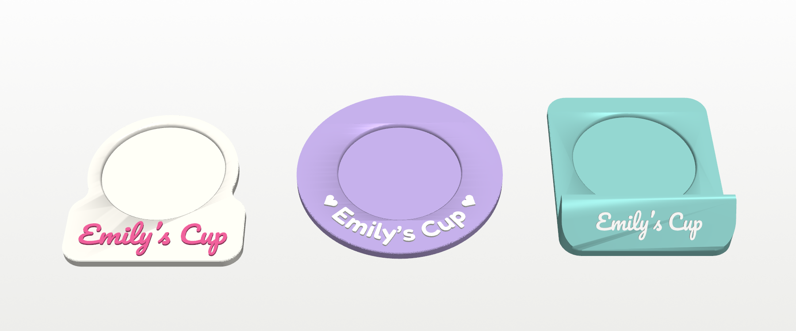
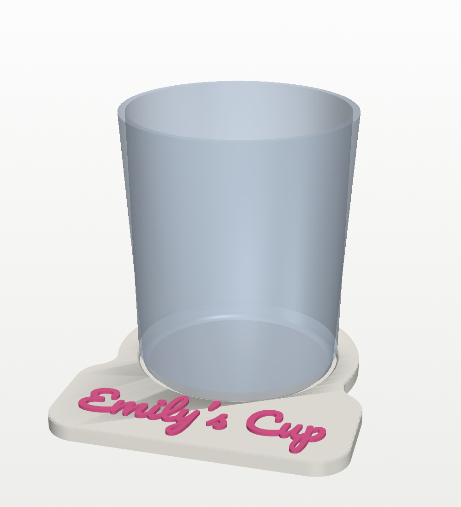
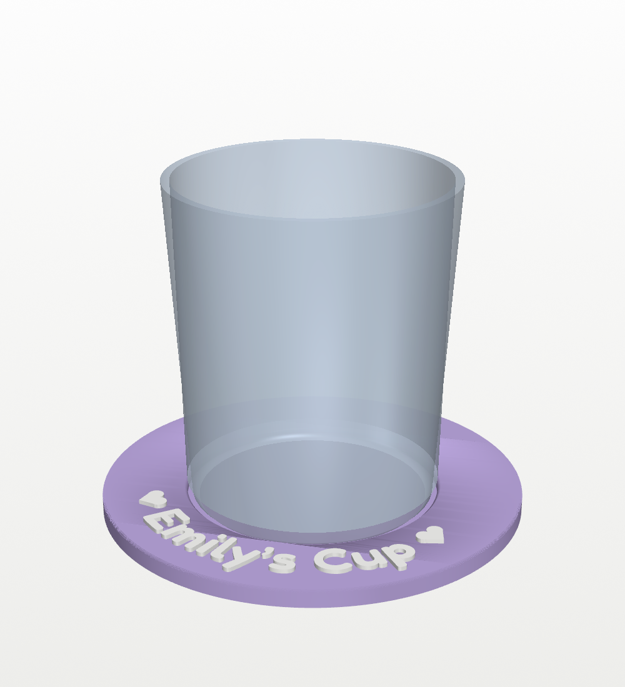
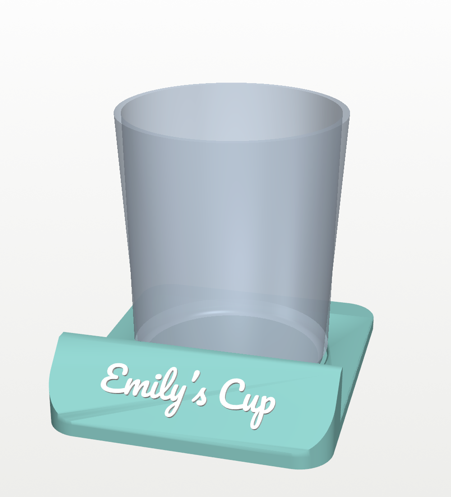

# Emily's Cup

A little stand to park a 70 mm cup on, with "Emily's Cup" on it in raised
letters. There are three designs to pick from. Each has a shallow pocket the
cup drops into, so it sits in the same spot every time, and the letters
print in a second colour.



| | Design | Size | Lettering |
|---|---|---|---|
|  | **1. Name tab:** a round coaster with a rounded tab out the front | 102 × 111 × 6.6 mm | Pacifico (script), pink on white |
|  | **2. Arch:** a wide round coaster with the name curving round the front of the rim and a heart at each end | 122 mm across, 6.6 mm tall | Fredoka (rounded), white on lilac |
|  | **3. Nameplate:** a coaster with a 45° ramp across the front, like a desk name sign, so the name faces you | 98 × 118 × 26 mm | Pacifico (script), white on mint |

The colours are only suggestions: change them in Bambu Studio.

## Portrait version

A take on the arch design (2) with no hearts: a line drawing of the person's
face sits in the floor of the pocket, so when the cup's not there she's
smiling up at you. The drawing and the name are on the same second filament,
so it's still two colours on the AMS (the project uses lilac and dark
purple).

- **The drawing** is made from a selfie by `portrait.py`. It finds the face
  and the outlines of the hair, face, neck and clothes, then draws the
  borders between them, the hair's flow round the face, the eyebrows,
  smiling eyes, nose, smile and a few freckles. It fills a 68 mm circle with
  a ring round it.
- **Flush:** the lines are inlaid 0.6 mm (3 layers) into the pocket floor
  and come up level with it, so the cup still sits flat. Every line is at
  least 0.8 mm wide.
- **Private:** the photo, the drawing and the build made from it are a real
  person's likeness, so `portrait.py` writes them to `private/`, which git
  ignores. Only the script is in the repo.

```
pip install mediapipe opencv-python-headless   # plus the packages below
xvfb-run -a python3 portrait.py photo.jpg      # -> private/
```

That writes `private/portrait.png` (the drawing, to check), renders in
`private/images/`, the STLs in `private/stl/` and the Bambu Studio project
`private/emilys_cup_portrait.3mf`, set up like the other projects below.
Look at `portrait.png` before printing: a busy background or a hand near
the face can add stray lines. `HEAD_ZOOM` and `HEAD_UP` frame the face,
`FRECKLES` and `STRANDS` set the details, and `LINE` sets the line width.
MediaPipe needs `libegl1` on Linux, and its two models download into
`private/models/` the first time.

## Lithophane version

Another take on the arch design, with no hearts: the photo itself, as a
lithophane. That's a white disc whose thickness follows the photo, thin
where the photo is light and thick where it's dark. It looks like a plain
white disc until light shines through it, then the photo appears.

- **How it fits:** the base has a 64 mm window right through the pocket
  floor, with a 1.4 mm ledge round it. The 72.6 mm disc drops into the
  pocket, flat side up, and rests on the ledge. The cup stands on the flat
  side, 3 mm down in the pocket as usual.
- **To see it:** lift the coaster up to a lamp or a window, or stand it on
  a phone's torch, with the cup off.
- **The disc** is 0.8 mm thick at the lightest parts of the photo and 3 mm
  at the darkest. The background is faded to white, so she stands out
  against a bright glow, and a dark ring at the edge frames her.
- **Printing:** the base is two colours (lilac with white letters) on the
  AMS. Print the disc separately in white PLA, flat side down, with 0.16 mm
  layers and 100% infill (its project is already set up that way). Turn the
  disc over to drop it in. Use plain white PLA, not silk or matte, because
  they let less light through.
- **Private:** like the line art, it's built from a photo, so everything
  goes in the git-ignored `private/` folder.

```
xvfb-run -a python3 lithophane.py photo.jpg    # -> private/
```

That writes `private/lithophane_preview.png` (roughly how it looks lit from
behind), renders in `private/images/`, the STLs, and two Bambu Studio
projects: `emilys_cup_litho_base.3mf` and `emilys_cup_litho_disc.3mf`.
`T_MIN` and `T_MAX` set the disc's thickness range, `GAMMA` lightens or
darkens the midtones, and the face is framed like the line art's.

## Fit

- **Pocket:** 73 mm across and 3 mm deep, with a 1 mm chamfer round the top
  edge to guide the cup in. That's 1.5 mm of room each side of a 70 mm cup
  bottom.
- **Measure the bottom of the cup**, not the rim. If it's not 70 mm, change
  `CUP_D` in `build.py` and rebuild; every design resizes round it.
- The floor under the cup is 2.4 mm thick.

## Printing

Open the design's project in Bambu Studio: `emilys_cup_tab.3mf`,
`emilys_cup_arch.3mf` or `emilys_cup_nameplate.3mf`. Each has one plate on
**0.20mm Standard @BBL A1**, with the base on filament 1 and the letters on
filament 2 (AMS).

| Setting | Value | Why |
|---|---|---|
| Supports | off | the steepest overhang is the underside of the nameplate's letters, at 45° |
| Brim | off | it lies on a wide flat bottom |
| Walls | 3 | |
| Infill | 15% | |
| Flush into infill | on | the purge between colours goes into the base's infill |

- **Filament:** about 35 g for the tab, 45 g for the arch and 65 g for the
  nameplate (my estimates from the volume; Bambu Studio will show the exact
  amount when you slice).
- **No AMS?** On the tab and the arch the letters sit on the flat top, so
  they start at one height: print from the STL and add a filament change
  (right-click the layer slider, "Add pause") at the first layer above
  5.4 mm. The nameplate's letters are on a slope, so they need the AMS, or
  print it in one colour and paint the letters.
- The letters stand 1.2 mm proud. Every stroke is at least 0.8 mm wide (the
  build script checks it).

## Changing it

The parameters at the top of `build.py` set:

- `NAME`, the text (it fits itself to each design, so a different name works)
- `CUP_D`, `CLEARANCE`, `POCKET_DEPTH` and `FLOOR`, the pocket
- `LETTER_H`, how far the letters stand up
- `TAB_W` and `TAB_TEXT_W` for the tab, `ARCH_D`, `ARCH_TEXT_CAP` and
  `ARCH_TEXT_R` for the arch, and `RAMP_RISE`, `RAMP_ANGLE` and
  `PLATE_TEXT_W` for the nameplate

The script stops with an error if the name would run into the pocket or off
the edge, if a stroke is too thin to print, or if a mesh is broken.

```
pip install trimesh numpy manifold3d matplotlib vtk pillow
python3 build.py               # -> stl/
xvfb-run -a python3 render.py  # -> images/ (drop xvfb-run on a desktop)
python3 make_3mf.py            # -> emilys_cup_*.3mf
```

## Files

| File | What |
|---|---|
| `build.py` | Builds all three designs. Its key dimensions are parameters at the top. |
| `render.py` | Preview renders (VTK), with a 70 mm cup for scale. |
| `portrait.py` | Builds the portrait version from a photo, into `private/`. |
| `lithophane.py` | Builds the lithophane version from a photo, into `private/`. |
| `make_3mf.py` | Builds the Bambu Studio projects with `../tools/bambu3mf.py`. |
| `emilys_cup_*.3mf` | The three Bambu Studio projects, ready to slice. |
| `stl/` | `<design>.stl` (the base) and `<design>_text.stl` (the letters) for each design. |
| `fonts/` | Pacifico and Fredoka SemiBold, from Google Fonts, under the SIL Open Font License (`OFL-*.txt`). |
