# Figure skate stand

A plain round stand that holds a figure skate upright on a table. The blade
drops into a groove across the top and the skate stands on its own.

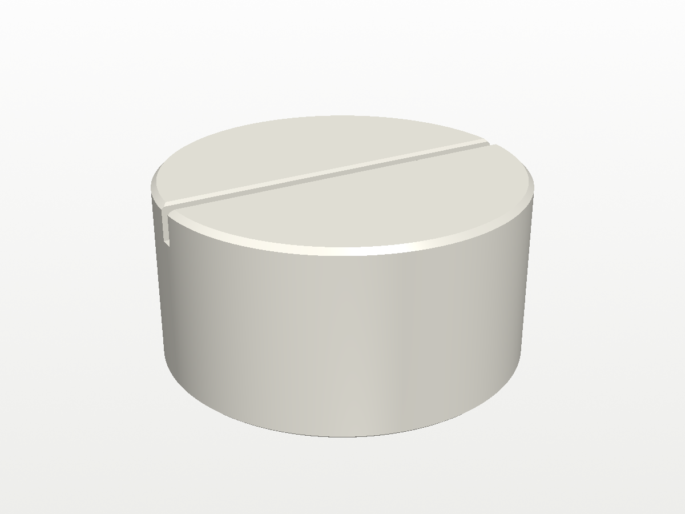

| | |
|---|---|
|  | 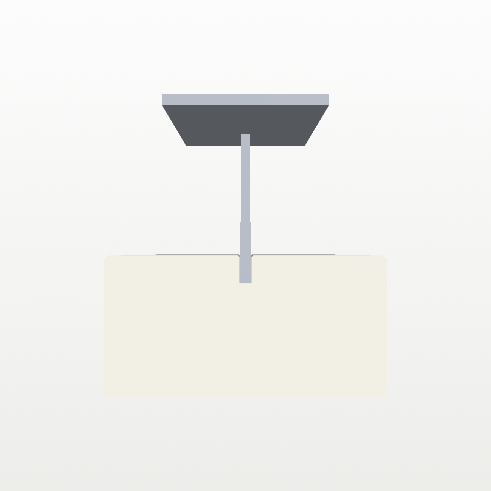 |

The grey blade in the renders is a rough stand-in, just for scale.

There are four versions, all with the same groove:

| | 2 in tall | 1 in tall |
|---|---|---|
| **4 in across** | `figure_skate_stand.3mf` | `figure_skate_stand_short.3mf` |
| **3 in across** | `figure_skate_stand_3in.3mf` | `figure_skate_stand_3in_short.3mf` |

| 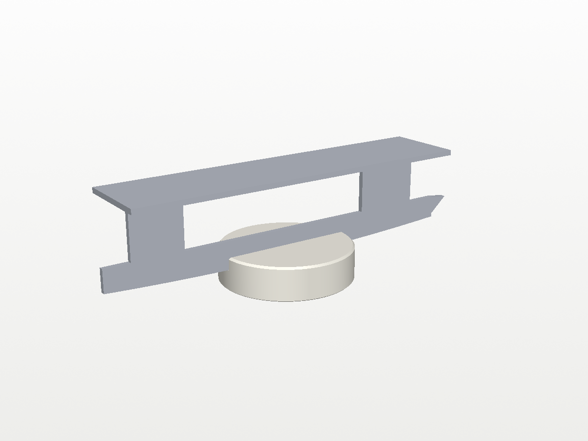 | 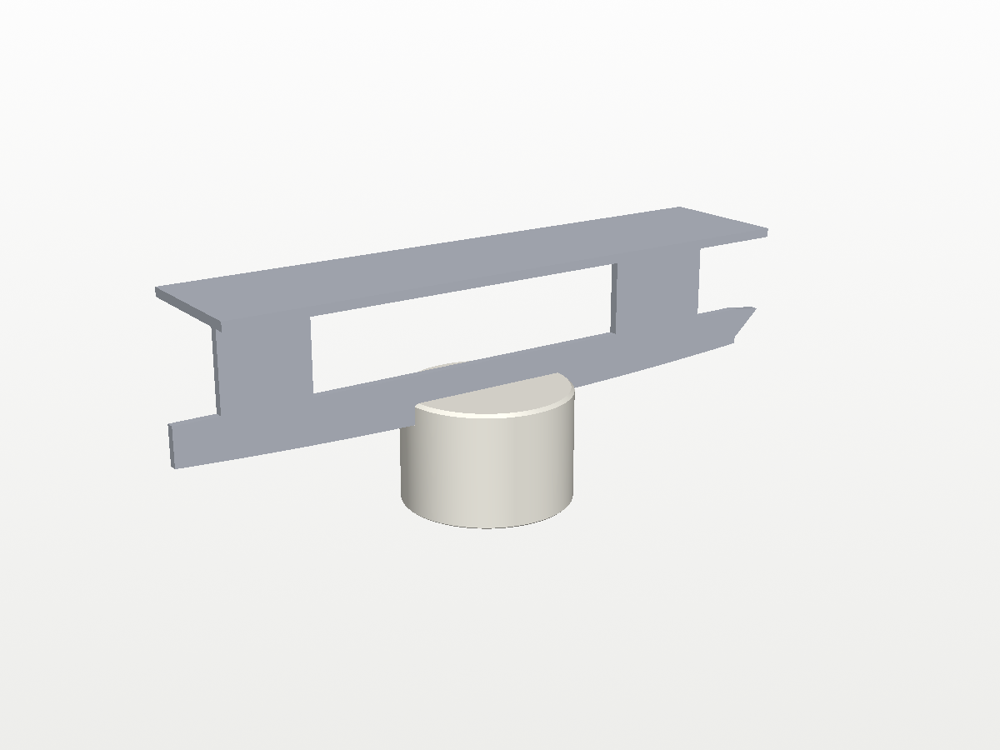 |  |
|---|---|---|
| 4 in across, 1 in tall | 3 in across, 2 in tall | 3 in across, 1 in tall |

## Gingerbread man

A small gingerbread man to hold up the back of the skate, alongside a round
stand. He's 1.5 in (38.1 mm) across from hand to hand, half the 3 in stand,
and 47.5 mm from head to feet, and lies flat like a cookie. He comes in the
same two heights as the round stands, so the blade sits level across both:

| | 2 in tall | 1 in tall |
|---|---|---|
| **Gingerbread man** | `gingerbread_skate_stand.3mf` | `gingerbread_skate_stand_short.3mf` |

| 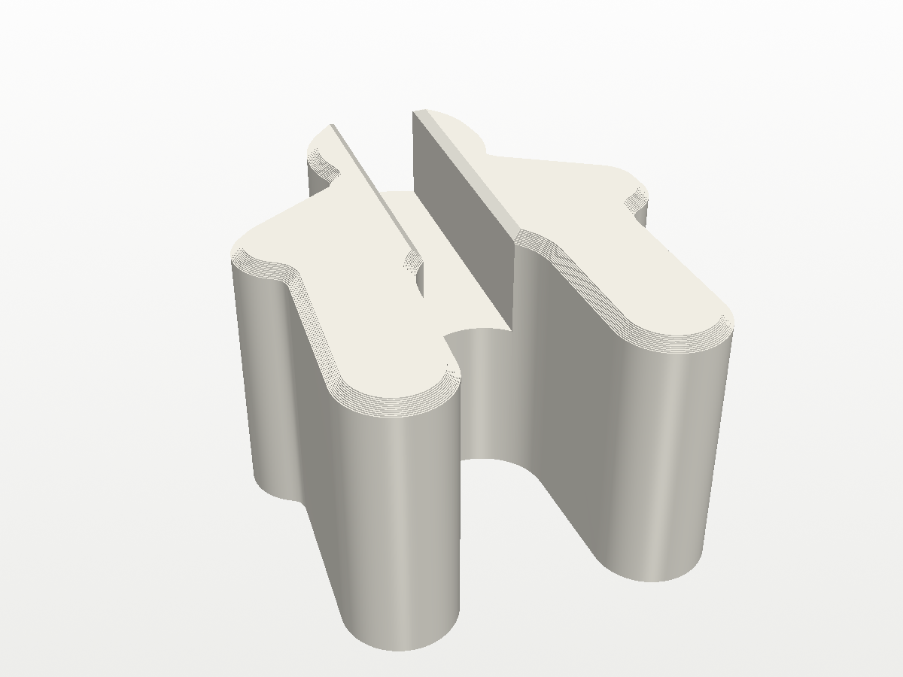 | 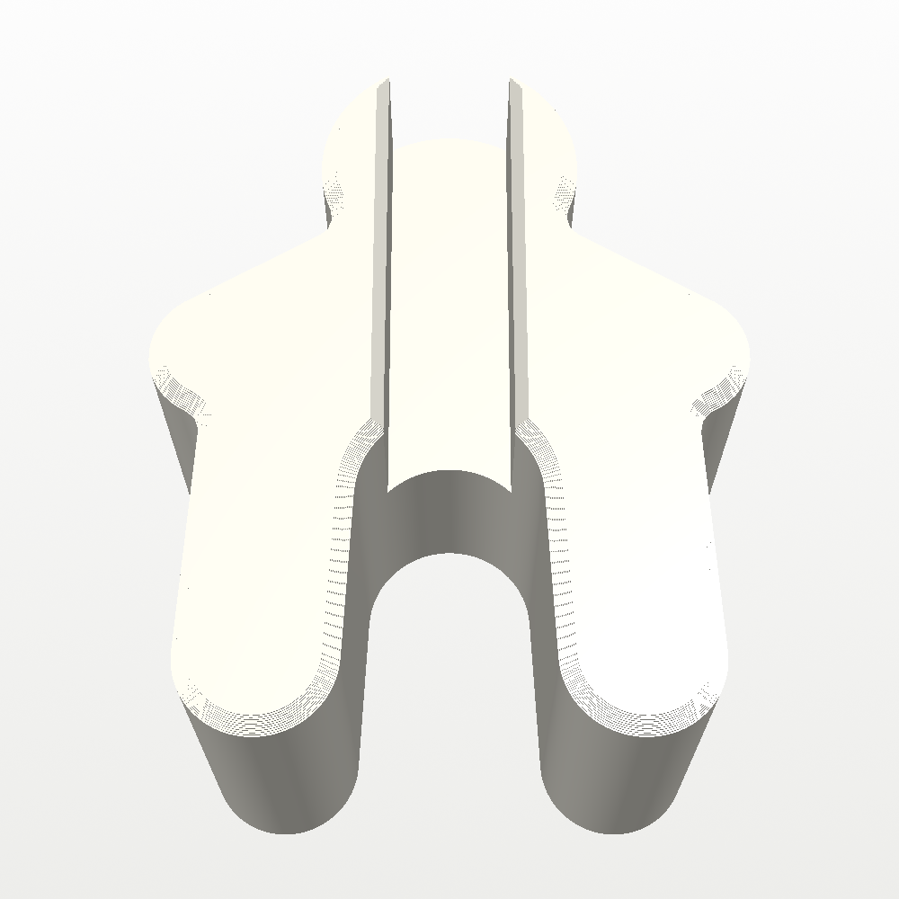 |
|---|---|
| 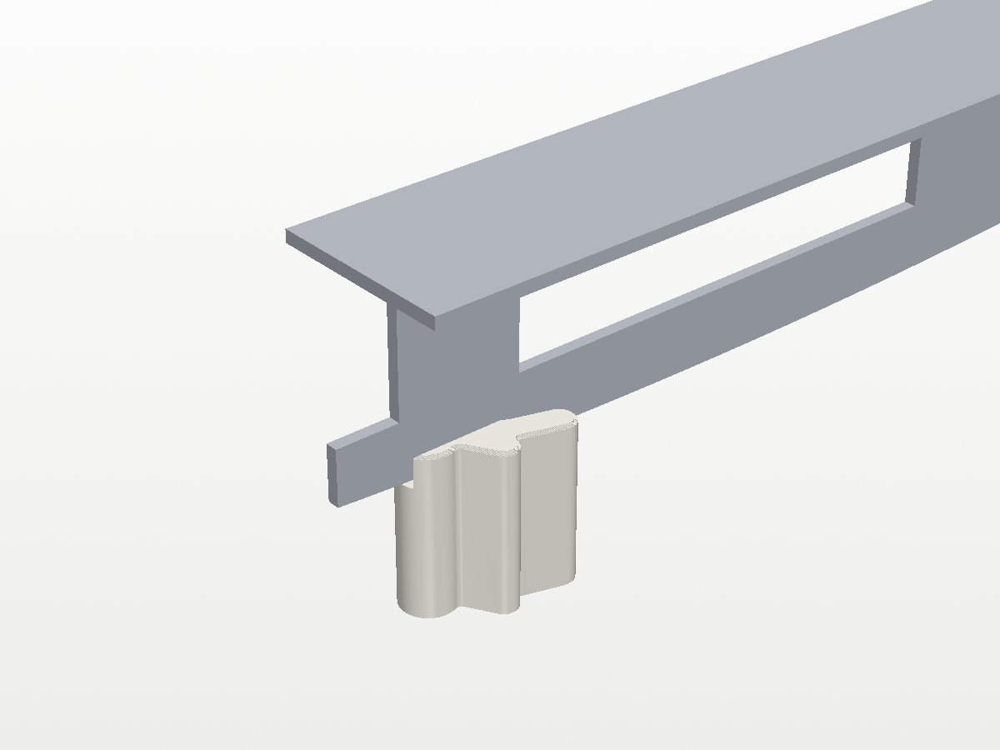 | 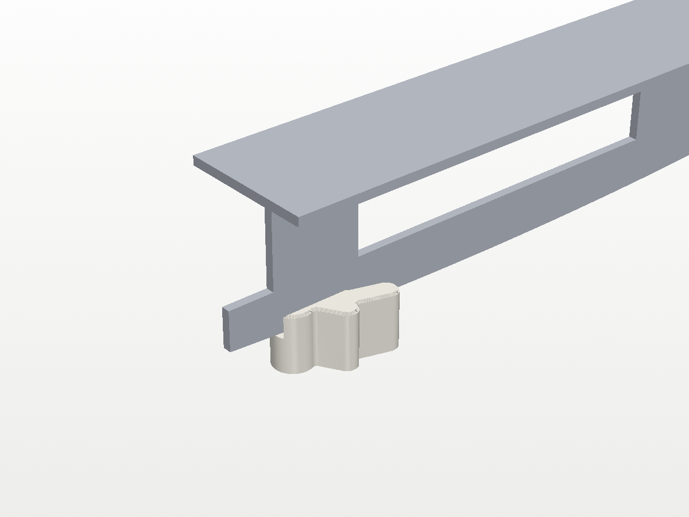 |

- **Groove:** 8.2 mm wide, twice the round stands', for a blade bedazzled
  on both sides, and the same 10 mm deep. It runs down his middle from the
  top of his head to his crotch and comes out between his legs, with the
  same 0.8 mm lead-in along its top edges.
- **Walls:** the narrowest part left beside the groove is about 3.7 mm, at
  his neck.
- **The blade's curve:** near the heel the blade's rocker lifts it a couple
  of millimetres, so it may sit a little above the groove floor here when
  the round stand is the same height. It is still well down in the groove.
- **Edges:** 1 mm chamfer round the top and 0.4 mm round the bottom.
- **Fit:** if the bedazzled blade is tight, raise `GB_GROOVE_W` in
  `gingerbread.py` and rebuild.

## Standing gingerbread man

The boot is heavy at the back, so a skate standing in a round stand at the
middle of its blade wants to tip backwards. This gingerbread man stands
behind the skate, facing the audience, and holds the back tip of the blade
in his hands so it can't.

| 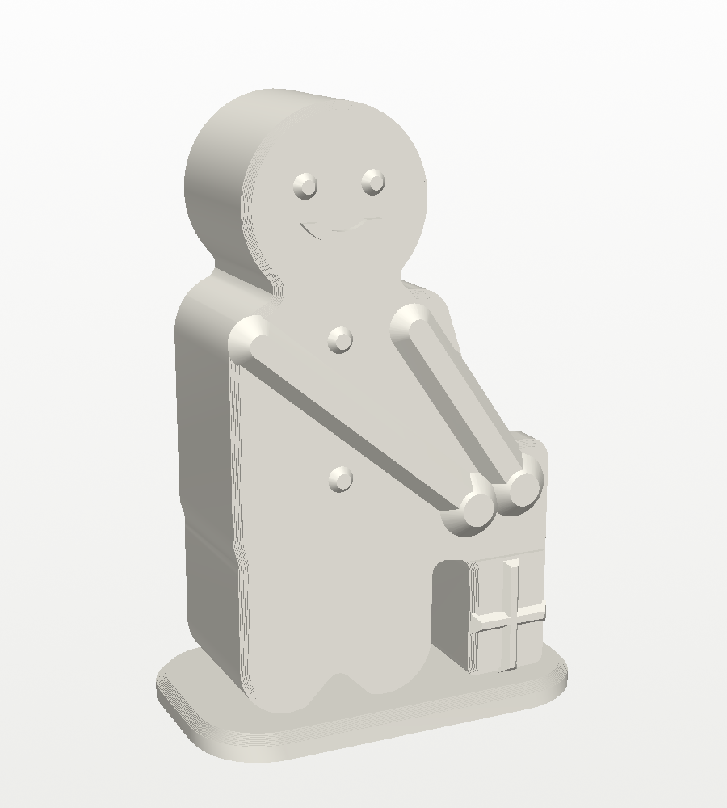 | 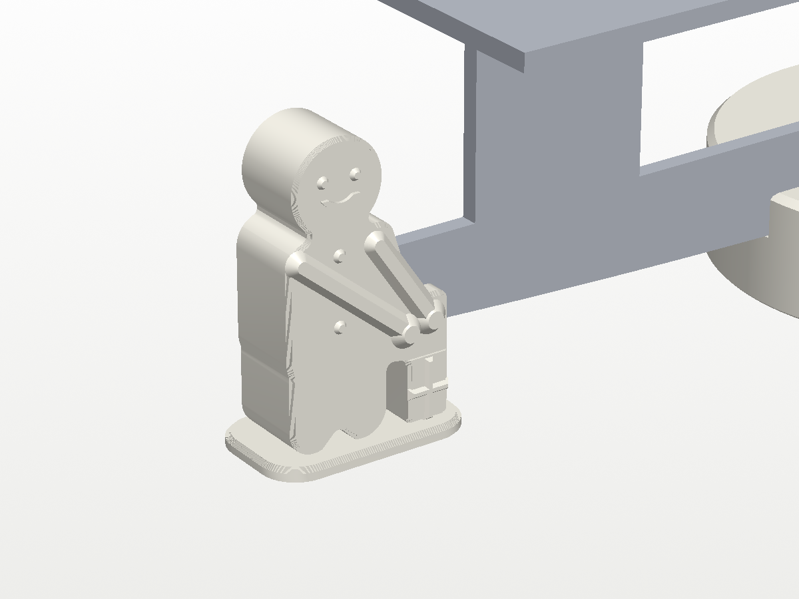 |
|---|---|

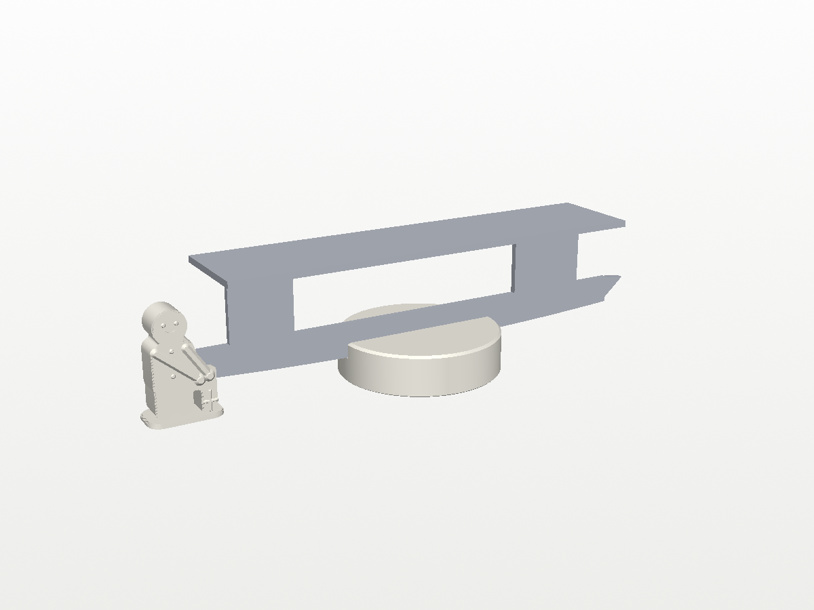

- **Project:** `standing_gingerbread.3mf`, with the same display settings as
  the others. He prints standing up, with no supports.
- **Size:** 66 mm tall on a 3 mm base, 44.5 × 26 mm across the base. He's a
  thick cookie, 18 mm front to back.
- **Hands:** both arms reach down to his mittens, which sit on a little gift
  box beside him. The box carries the skate's weight down to the base.
- **Slot:** in his hands, 8.2 mm wide for the bedazzled blade and 10 mm
  deep. It's open at the top and at the end facing the skate, and closed at
  his end, so the blade's tip butts against his hands.
- **Height:** the slot's floor is 19.4 mm above the table. That's where the
  bottom of the blade's back tip should be with the skate's middle in the
  **1 in** round stand: the stand's groove floor is 15.4 mm up, and the
  blade's curve lifts its back end about 4 mm more. Blades differ, so stand
  the skate in the round stand and measure from the table to the bottom of
  the blade about 1 cm from its back tip. If it's not 19.4 mm, set
  `HOLD_Z` in `standing_gingerbread.py` to your measurement and rebuild. A
  millimetre or so either way does no harm: slightly low and the skate leans
  back that much before he catches it; slightly high and he lifts it a
  little.
- **Placing him:** set the skate in the round stand, then slide him in from
  behind so the blade's tip goes into his hands.
- **Clearance:** he stays clear of the boot because he stands past the end of
  the blade, and his head (66 mm) is beside the heel, not under it.

## Size (round stands)

- **Disc:** 101.6 mm (4 in) or 76.2 mm (3 in) across, and 50.8 mm (2 in)
  or 25.4 mm (1 in) tall, solid. The 3 in disc tips more easily than the
  4 in one, so try it with the real skate. Even on the short one, the blade
  stands about 15 mm clear of the table.
- **Groove:** 4.1 mm wide and 10 mm deep, straight across the whole top and
  out both sides, so a blade of any length fits. The blade's rocker (its
  curve) lifts its ends only about 0.6 mm over 4 in, so a
  straight groove holds it along its full length.
- The groove has a 0.8 mm lead-in along both top edges to guide the blade
  in, the top edge of the disc has a 1.5 mm chamfer, and the bottom edge
  has a 0.6 mm chamfer so the first layer doesn't leave a lip.

## Printing

Open the project for the version you want (see the table above) in Bambu
Studio and print. Each is set up for a display finish on
**0.12mm Fine @BBL A1**, with the stand groove up. Print in white PLA;
matte white (such as Bambu PLA Matte Ivory White) hides layer lines best.

| Setting | Value | Why |
|---|---|---|
| Layer height | 0.12 mm | the sides show almost no layer lines |
| Seam position | Back | the stand is turned so the groove runs front to back, which puts the seam under the heel end of the blade |
| Scarf joint seam | Contour | blends the seam in |
| Walls | 4 | white PLA lets light through; thick walls stop the infill showing |
| Top shell | 1.2 mm | same reason, for the top |
| Ironing | Topmost surface | a smooth, even top face |
| Outer wall | 80 mm/s, 2000 mm/s² | slower than the preset, for an even surface |
| Infill | 15%, gyroid | |
| Supports | off | the groove is open at the top, so nothing overhangs |
| Brim | off | it lies on a wide flat bottom |

- **Display it** with the seam (the side that was at the back of the
  plate) under the heel of the blade, facing away from people.
- **Before printing:** white shows every speck, so if the printer last ran
  a dark colour, run some white through first and wipe the nozzle. Use dry
  filament and a clean plate. Felt pads underneath give a finished look and
  protect the table.
- **Filament:** about 120 g for the 4 in tall one, 65 g for the 4 in short
  one, 70 g for the 3 in tall one, 40 g for the 3 in short one, and 30 g
  and 15 g for the tall and short flat gingerbread men, and 25 g for the
  standing one (my estimates; Bambu Studio will show the exact amount and the print time
  when you slice). The stand weighs little next to a skate, so more infill
  won't make it noticeably steadier.
- **Fit:** printed slots often come out a touch narrower than drawn. If the
  blade is tight, raise `GROOVE_W` to 4.2 or 4.3 and rebuild; if it's
  loose, lower it.

## Changing it

The parameters at the top of `build.py` set the disc (`DISC_D`, `SMALL_D`, `DISC_H`, `SHORT_H`,
`TOP_CHAMFER`, `FOOT_CHAMFER`) and the groove (`GROOVE_W`, `GROOVE_DEPTH`,
`GROOVE_LEAD`). The script checks the mesh is watertight and measures the
groove's width and depth before writing the STL.

`gingerbread.py` builds the gingerbread man. Its parameters set his size
(`WIDTH`), his head, body, arms and legs, the groove (`GB_GROOVE_W`, which is
twice the round stands' `GROOVE_W`) and the chamfers. It checks the mesh, the
groove and that the groove comes out between his legs.

`standing_gingerbread.py` builds the standing gingerbread man. `HOLD_Z` sets
the height of the slot's floor, and the parameters below it set his
proportions, his hands and the gift box. It checks the mesh, the slot's
width and floor height, and reports any part of his outline that overhangs
more than 45 degrees. There are only two: the rounded undersides of his feet,
in the first 3 mm above the base, and a 4 mm bridge under his hands between
his leg and the gift box. Both print fine without supports.

```
pip install trimesh numpy manifold3d vtk
python3 build.py               # -> stl/ (the four round stands)
python3 gingerbread.py         # -> stl/ (the two flat gingerbread men)
python3 standing_gingerbread.py  # -> stl/standing_gingerbread.stl
xvfb-run -a python3 render.py  # -> images/ (drop xvfb-run on a desktop)
python3 make_3mf.py            # -> the *.3mf projects
```

## Files

| File | What |
|---|---|
| `build.py` | Builds all four stands. Its key dimensions are parameters at the top. |
| `gingerbread.py` | Builds the gingerbread men. |
| `standing_gingerbread.py` | Builds the standing gingerbread man. |
| `render.py` | Preview renders (VTK), with a stand-in blade for scale. |
| `make_3mf.py` | Builds the Bambu Studio projects with `../tools/bambu3mf.py`. |
| `figure_skate_stand.3mf` | The Bambu Studio project for the 2 in stand, ready to slice. |
| `figure_skate_stand_short.3mf` | The same for the 1 in stand. |
| `figure_skate_stand_3in*.3mf` | The same two, 3 in across. |
| `gingerbread_skate_stand*.3mf` | The flat gingerbread man, 2 in and 1 in tall. |
| `standing_gingerbread.3mf` | The standing gingerbread man. |
| `stl/` | `stand.stl`, `stand_short.stl`, `stand_3in.stl`, `stand_3in_short.stl`, `gingerbread.stl`, `gingerbread_short.stl` and `standing_gingerbread.stl`. |
