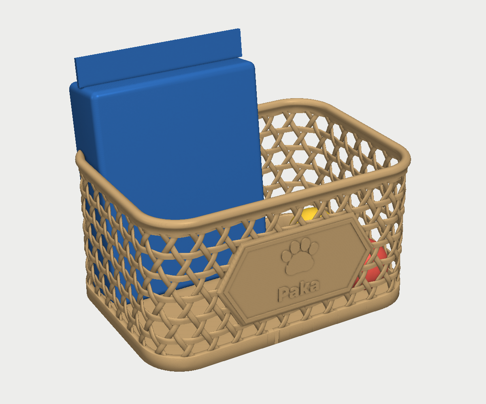
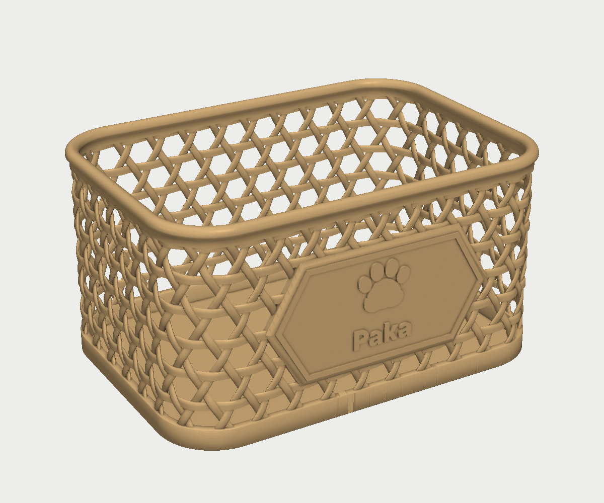
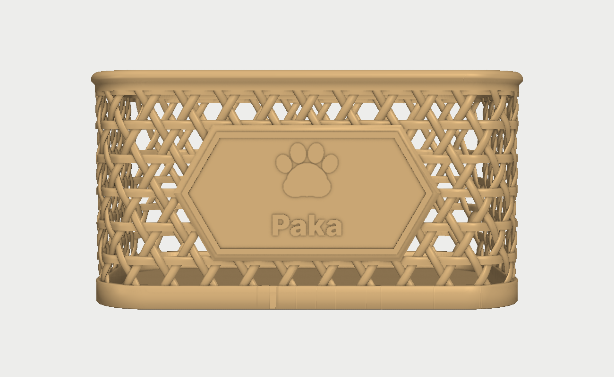
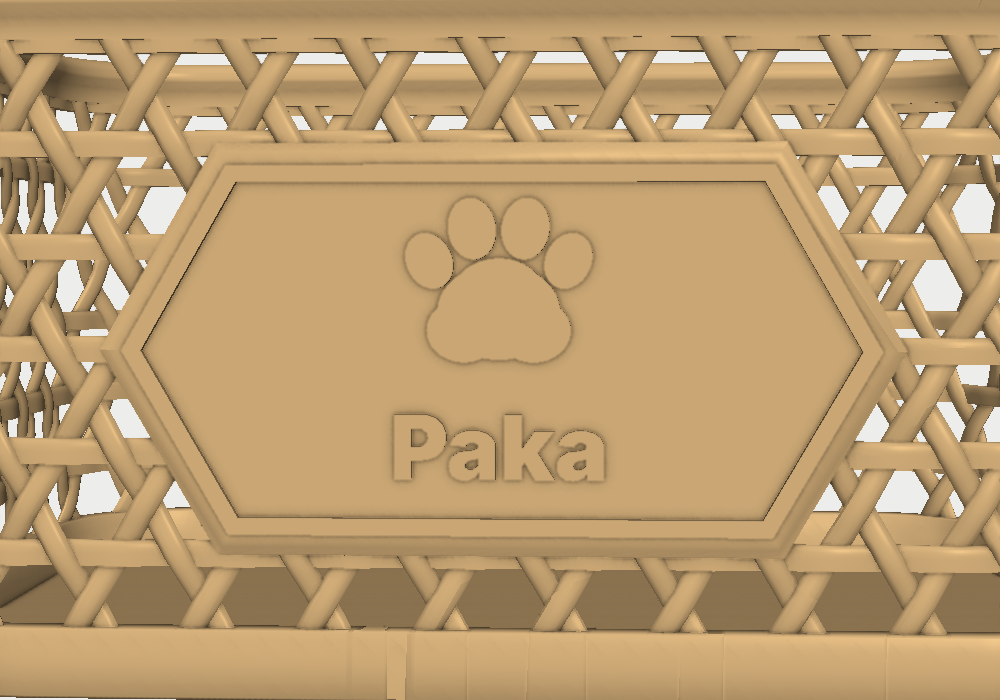
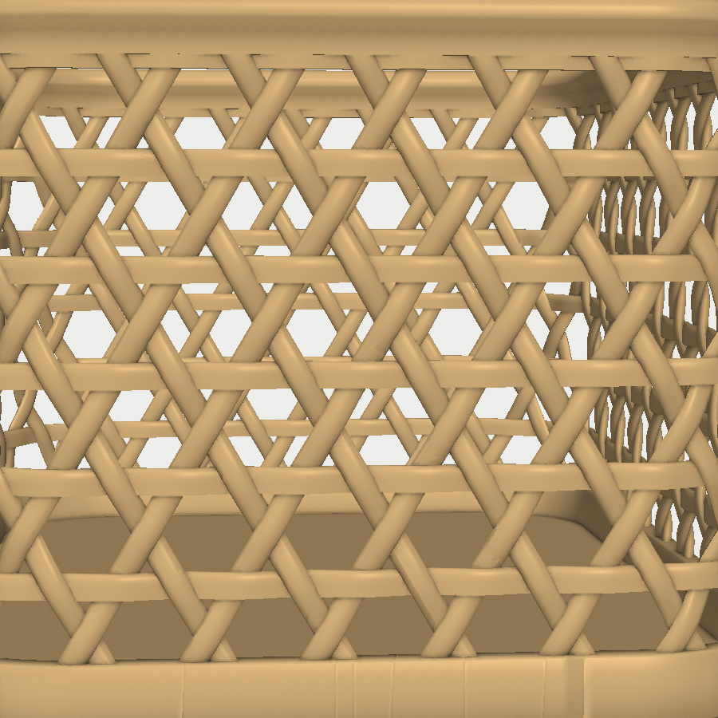
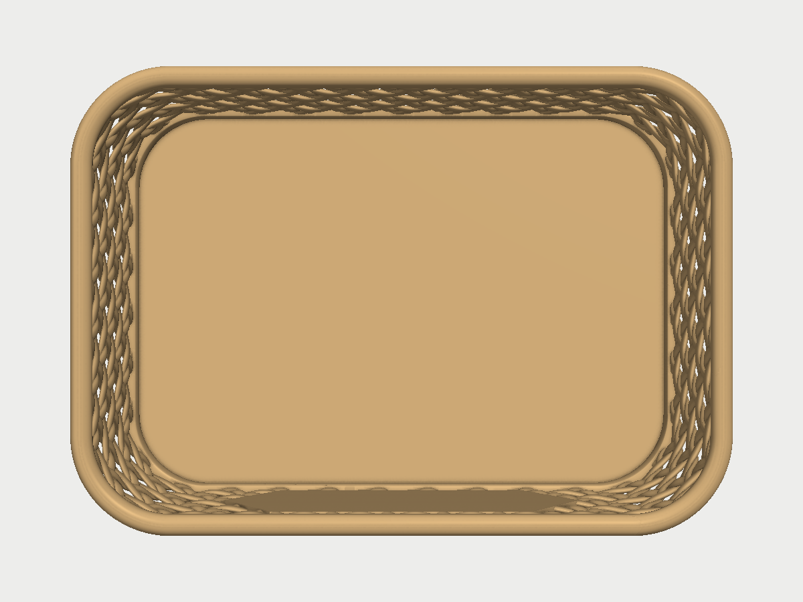

# Paka's basket

A countertop basket for cat supplies: bags of treats, small toys and the
like. It's woven in an open hexagonal cane pattern, like a cane chair seat,
and has a hexagonal plaque on the front with a paw print and the name
**Paka**. The open weave saves filament and print time. It's 207 × 148 mm
across and 110 mm tall, and it prints in one piece, in one colour, with no
supports, on a Bambu Lab A1.

| | | |
|---|---|---|
|  |  |  |
|  |  |  |

The first picture has a stand-up bag of treats (125 × 45 × 175 mm, about
the size of a 3 oz bag) and two 38 mm toy balls in it for scale.

## What it is

| | |
|---|---|
| **Size** | 207 × 148 × 110 mm outside. Inside it's 196 × 136 mm at the floor and 99 mm deep to the rim. |
| **Weave** | Three sets of reeds, one horizontal and two leaning at 60°, crossing to make hexagons with a small triangle at each corner (a *kagome* or triaxial weave). Each reed goes over, then under, the reeds it crosses. The reeds are 4 mm wide and 2 mm thick, 15.6 mm apart, so the hexagons are about 11 mm across inside: small toys won't fall through. Neighbouring reeds overlap by 0.8 mm where they cross, so the whole wall prints as one solid piece. |
| **Plaque** | A flat-topped hexagon 122 × 62.5 mm in the middle of the front, sitting between two horizontal reeds, with its slanted sides at 60° like the weave. Its face stands out 1.4 mm and is bevelled at 45° all round. A raised border, a paw print and "Paka" stand out a further 1.2 mm. They're the same colour as the basket, so the light and shadow on the relief make them stand out. |
| **Rim** | A rounded rim, 6.8 mm wide, that flares out and in at 45° from the top row of the weave. It stiffens the top edge. |
| **Base** | A solid band 11 mm tall round the bottom, and a solid 1.2 mm floor, so crumbs stay in the basket rather than falling onto the counter. |

## Printing

| Project | Filament | Process | Filament used (my estimate) |
|---|---|---|---|
| `paka_basket.3mf` | one colour of PLA, no AMS (tan or natural in the pictures) | 0.20mm Standard @BBL A1, no supports, no brim | about 200 g |

Open `paka_basket.3mf` in Bambu Studio. It has the basket on the plate and
these settings changed from Bambu's standard 0.20 mm process:

- **Walls 3, Arachne wall generator.** The 2 mm reeds print as solid walls
  that follow the reeds where they cross.
- **6 bottom layers**, so the 1.2 mm floor prints solid.
- **Seam at the back**, away from the plaque.
- **Avoid crossing walls on**, for fewer travel marks across the open weave.

The filament estimate is mine, not the slicer's. Bambu Studio shows the
real weight and print time when it slices. There are a lot of small
separate islands in every layer, so expect it to take a while.

**Why it needs no supports:** the build script checks that nothing facing
down is steeper than 45° except the flat bridges and the 1.2 mm lettering.

- The 60° reeds hold themselves up.
- The horizontal reeds have flat bottoms and bridge at most 4.4 mm between
  the diagonal reeds.
- The rim flares out at 45°.
- The plaque's flat bottom edge sits on a horizontal reed, and its sides
  run at 60°.

The raised paw and letters stand out 1.2 mm from a vertical face, which
the A1 prints fine without support.

## Changing it

The key dimensions are parameters at the top of `build_basket.py`:

- `NAME` sets the name on the plaque, and `FONT` its font.
- `W`, `D` and `R` set the size and corner radius.
- `CELL` sets the size of the hexagons.
- `REED_W` and `REED_T` set how chunky the reeds are.
- `FLOOR_T` sets the floor thickness.

The weave adjusts its spacing slightly so the pattern closes round the
basket. The script stops with a message if the paw or the name run into the
plaque's border, or if anything would need support.

```
pip install numpy trimesh manifold3d shapely matplotlib vtk
python3 build_basket.py              # stl/basket.stl (and stl/treat_bag.stl, the stand-in for the pictures)
xvfb-run -a python3 render.py        # images/
python3 make_3mf.py                  # paka_basket.3mf
```

`stl/treat_bag.stl` is only for the pictures. Don't print it.
