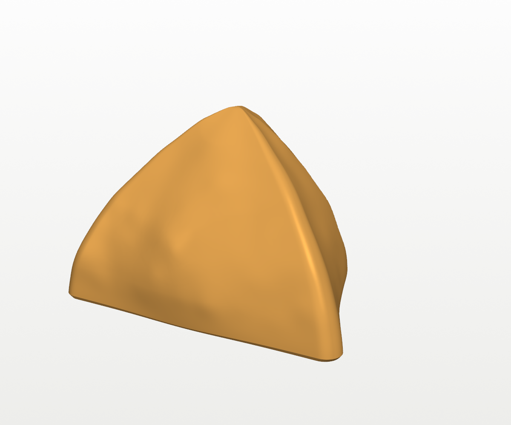
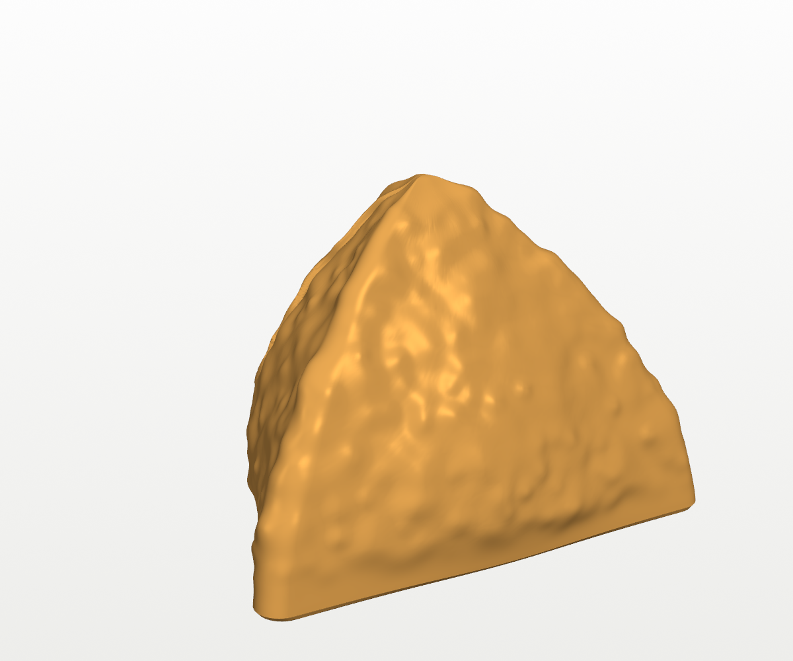
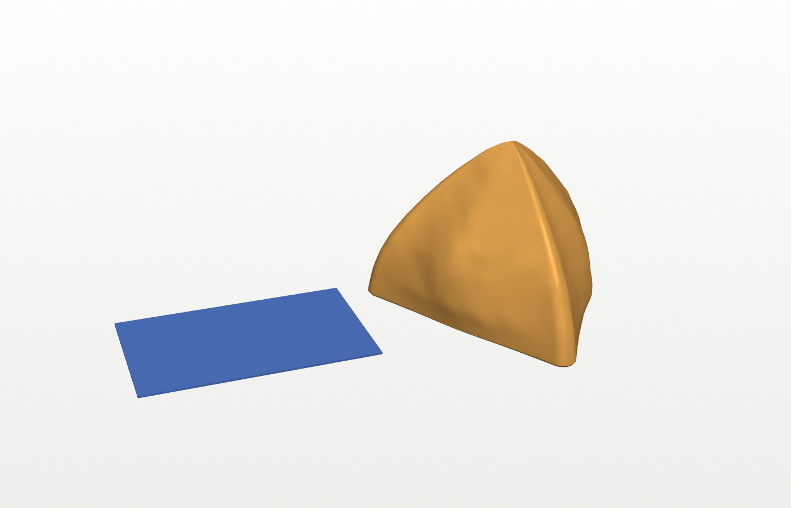
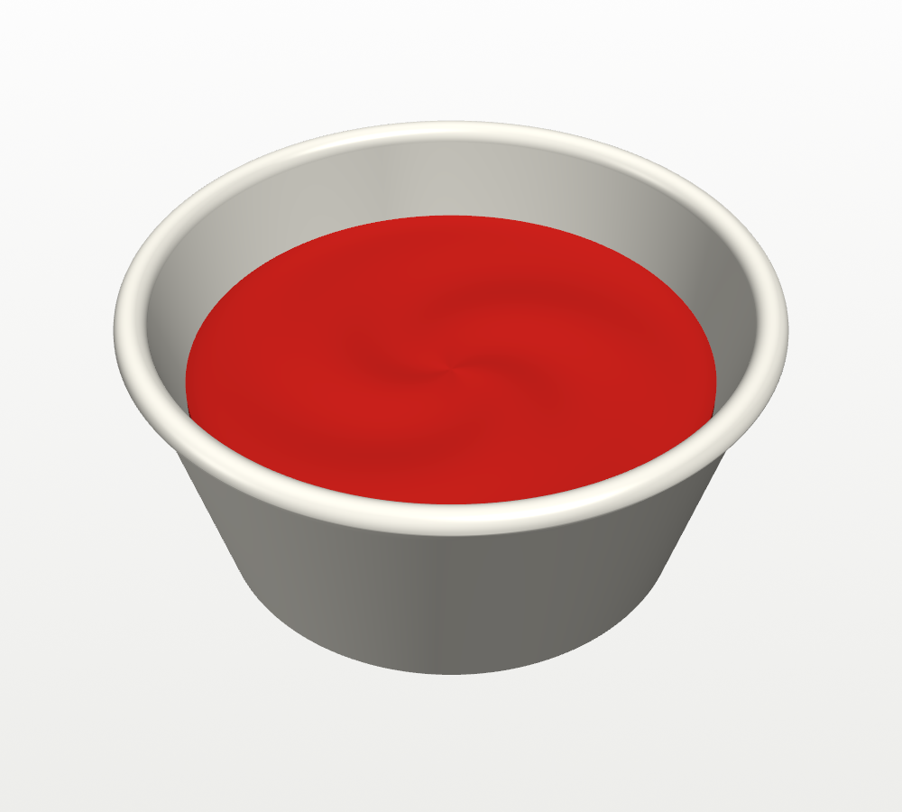
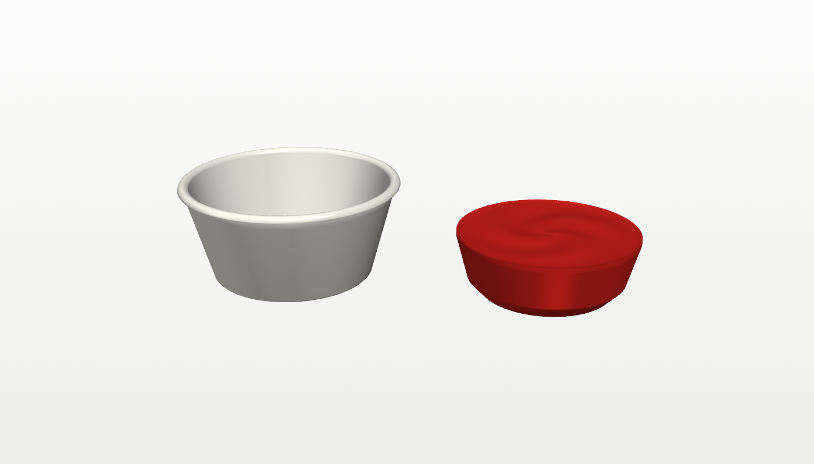
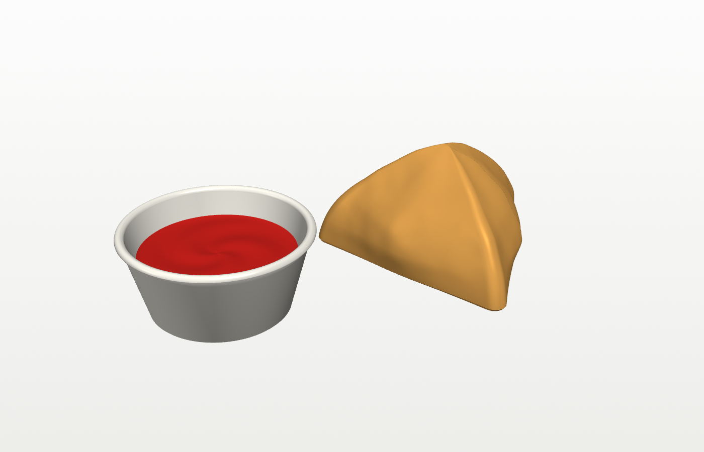

# Samosa

A life-size samosa, standing on its flat triangular bottom the way it sits
on a plate. It's the size of a real Punjabi samosa: 86 × 78 mm across the
bottom and 44 mm tall, so it fits in a box with a 45 mm gap. Lay it on its
side, with the tip pointing to the front or back of the box. It prints in
one piece, in one colour, with no supports.

It comes with a white dipping cup and a red sauce insert. Each prints on
its own in one colour, so you don't need an AMS.

| | | |
|---|---|---|
|  |  |  |

The last picture shows it next to a credit card (85.6 × 54 mm) for size.

## What it is

- **Shape:** a plump three-sided pastry cone. The bottom is a triangle with
  rounded corners, about 92 mm on each side if the corners were sharp. The
  faces bulge out where the filling pushes the pastry, and the top comes to
  a rounded point.
- **Seam:** one face has the overlapping flap where the pastry was folded
  and sealed, with a slightly wavy edge, the way a hand-folded one looks.
- **Surface:** smooth pastry with a very slight hand-made unevenness and a
  few soft bubbles. The bottom 2 mm are smooth and flat so it sits flat on the bed and
  on a plate.

## Dipping cup and sauce

| | | |
|---|---|---|
|  |  |  |

- **Cup (white):** a small tapered sauce cup, 66 mm across the rim (68 mm
  over the lip) and 31 mm tall. That's wide enough to dip a corner of the
  samosa in. The wall is 2.2 mm thick with a rounded lip.
- **Sauce (red):** a solid insert shaped to the inside of the cup. It drops
  in, rests on the cup's floor and fills the cup two thirds of the way up
  (18 mm). The sauce creeps slightly up the cup wall at the edge and has a
  gentle swirl on top.
  - **Fit:** there's a 0.35 mm gap all round, so it drops in easily. A dab
    of glue holds it if you don't want it to come out.
  - **Size:** it's 55.5 mm across and 18.7 mm tall.
- **In the box:** the cup is 31 mm tall, so it fits the 45 mm box standing
  up, with the sauce in it.

## Printing

Open `samosa.3mf` in Bambu Studio. It has one plate with these settings on
top of **0.20mm Standard @BBL A1**:

| Setting | Value | Why |
|---|---|---|
| Supports | off | nothing overhangs more than 40°; the build script checks this |
| Brim | off | it stands on a wide flat triangle |
| Walls | 3 | |
| Infill | 15% | |
| Seam | aligned | keeps the seam to one line on the smooth surface |

- **Filament:** a tan, golden or light-brown PLA looks most like fried
  pastry. A matte PLA looks better still, because it hides the layer lines.
  The project uses the **Bambu PLA Basic** profile, so switch it to your
  filament's profile if it's different.
- **How much:** roughly 35 g of filament (my estimate from the model's
  volume and surface; Bambu Studio will show the exact amount and time when
  you slice).
- Or import `stl/samosa.stl` and use the settings above.

**Cup and sauce:** open `samosa_dip_cup.3mf` and print it in white, then
open `samosa_dip_sauce.3mf` and print it in red. Each is its own plate with
one filament, on **0.20mm Standard @BBL A1**, with no supports and no brim.

| Project | Part | Filament | Walls | Infill | Filament used (my estimate) |
|---|---|---|---|---|---|
| `samosa_dip_cup.3mf` | cup | white PLA | 4 (the wall prints solid) | 15% | about 20 g |
| `samosa_dip_sauce.3mf` | sauce | red PLA | 3 | 15% | about 15 g |

Both print upright as they sit. The steepest overhangs are the cup lip's
underside (39°) and the chamfer round the bottom of the sauce (43°). Or
import `stl/dip_cup.stl` and `stl/dip_sauce.stl` (`dip_assembled.stl` is
for viewing only).

**Making it look cooked:** for a school project, a quick dry-brush of darker
brown acrylic paint over the bumps picks out the seam and the soft bumps, and
makes it look fried.

## Changing it

The parameters at the top of `build_samosa.py` set:

- `SIDE` and `HEIGHT`, the size (92 mm and 44 mm; `HEIGHT` is its
  thinnest measurement, so keep it under 45 mm for the box)
- `FACE_BULGE` and `BELLY`, how plump it is
- `SEAM_STEP` and `SEAM_AT`, the folded flap
- `LUMP_AMP`, `BLISTERS`, `BLISTER_AMP` and `BLISTER_SIZE`, the surface
  (raise them for a bumpier, more blistered pastry)
- `SEED`, for a slightly different samosa each time (useful for printing a plateful)

The script stops with an error if a change makes any part overhang more than
40° (it would need supports) or breaks the mesh.

The parameters at the top of `build_dip.py` set the cup's size (`CUP_TOP_R`,
`CUP_BOT_R`, `CUP_H`), its `WALL` and `LIP`, how full it is (`SAUCE_LEVEL`),
the sauce's fit in the cup (`FIT`) and its `SWIRL`. It stops with an error if
the sauce wouldn't fit in the cup or anything would need supports.

```
pip install trimesh numpy scipy manifold3d vtk pillow
python3 build_samosa.py        # -> stl/samosa.stl
python3 build_dip.py           # -> stl/dip_cup.stl, dip_sauce.stl, dip_assembled.stl
xvfb-run -a python3 render.py  # -> images/ (drop xvfb-run on a desktop)
python3 make_3mf.py            # -> samosa.3mf, samosa_dip_cup.3mf, samosa_dip_sauce.3mf
```

## Files

| File | What |
|---|---|
| `build_samosa.py` | Builds the samosa. Its key dimensions are parameters at the top. |
| `build_dip.py` | Builds the dipping cup and the sauce. |
| `render.py` | Preview renders (VTK). |
| `make_3mf.py` | Builds the Bambu Studio projects with `../tools/bambu3mf.py`. |
| `samosa.3mf` | The samosa's Bambu Studio project, ready to slice. |
| `samosa_dip_cup.3mf`, `samosa_dip_sauce.3mf` | The cup's and the sauce's projects. |
| `stl/` | `samosa.stl`, `dip_cup.stl`, `dip_sauce.stl`, and `dip_assembled.stl` for viewing. |
