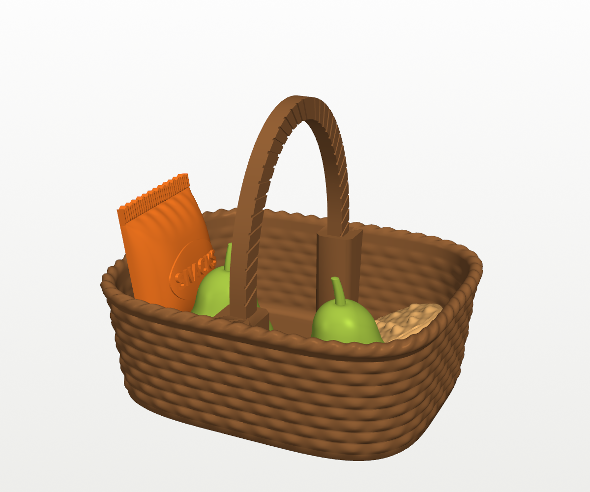
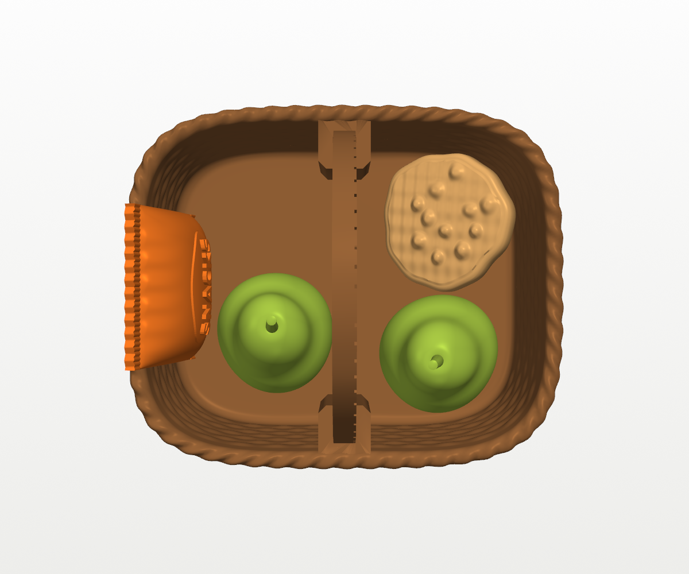
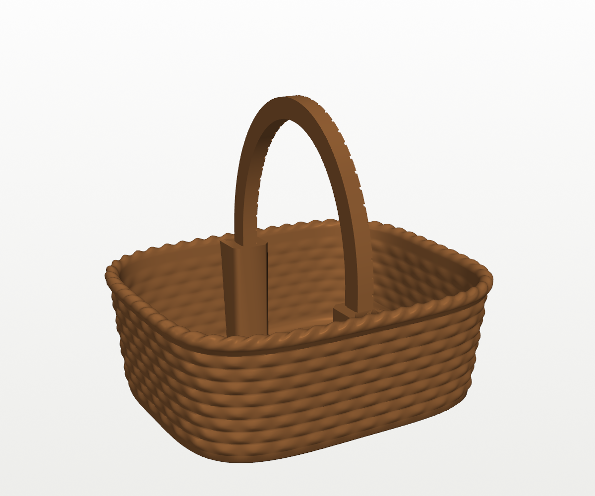
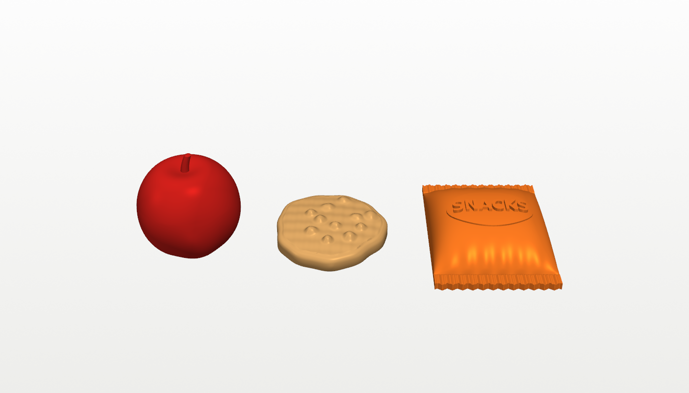
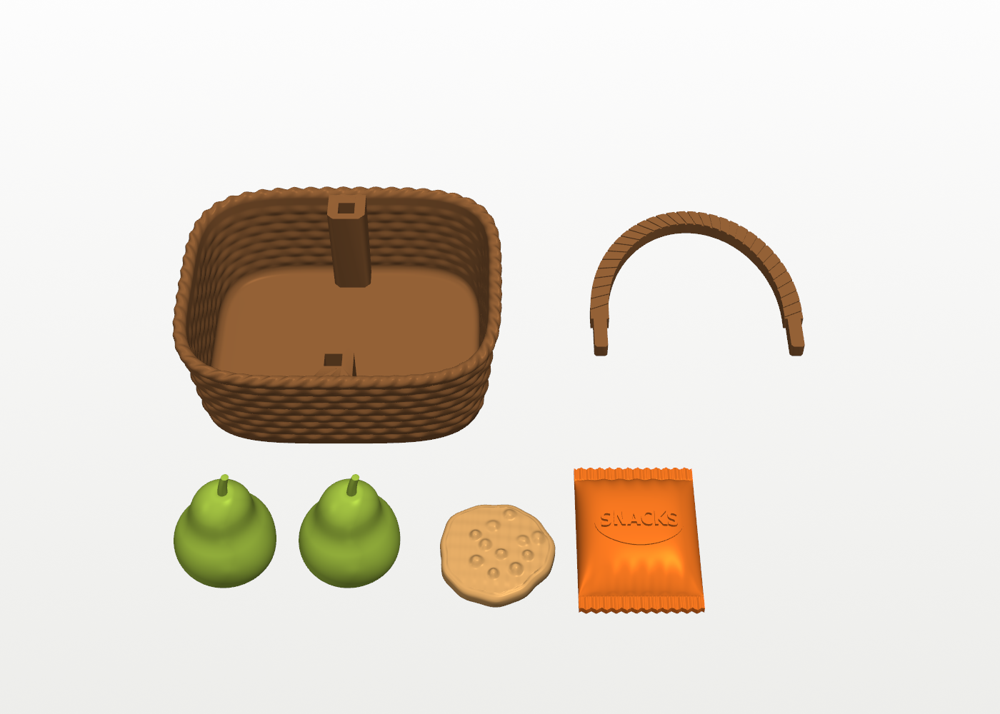
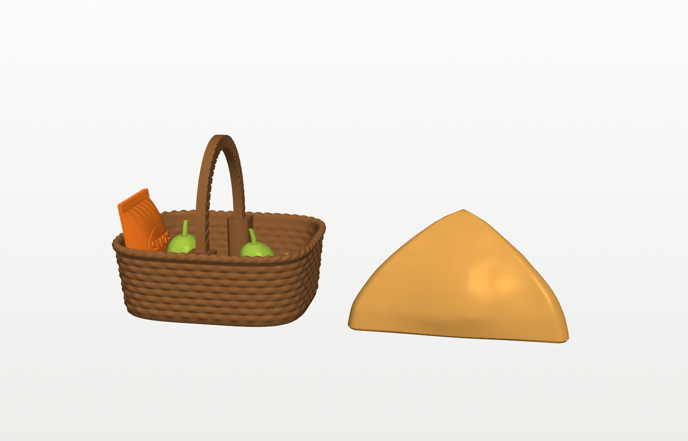

# Snack basket

A little brown wicker basket with a handle, and treats to put in it: two
pears, a chocolate-chip cookie and a bag of snacks. The basket is 83 × 69 mm
across the rim (a bit narrower than the [samosa](../samosa/), which is 86 mm)
and 30 mm deep, or 71 mm tall to the top of the handle. All the treats fit
inside together. The build script places them in the basket and checks they
don't poke through the basket, the handle or each other.

| | | |
|---|---|---|
|  |  |  |
|  |  |  |

The last picture shows it next to the samosa.

## What's in it

| Part | Size | What it looks like |
|---|---|---|
| **Basket** | 83 × 69 × 30 mm | Eight woven rows going over and under 36 stakes, a twisted rope rim, and a faint weave inside. Its outline is a rounded rectangle and it flares out slightly towards the top. A thick stake inside the rim on each long side has a socket for the handle. |
| **Handle** | 58 × 51 mm, 5 mm wide and 4 mm thick | An arch with slanted grooves, like a wrapped wicker handle. It prints flat. Its two pegs push down into the sockets, and its shoulders rest on top of the stakes. |
| **Pear** (×2) | 24 mm across, 34 mm tall | A round bottom with a narrower top that leans slightly to one side, and a curved stem in a little dimple. It stands on a small flat spot on its bottom. |
| **Cookie** | 28 mm across, 6 mm thick | Slightly domed, with an uneven edge and eleven chocolate chips on top. |
| **Bag of snacks** | 30 × 42 × 10 mm | A puffy bag with crimped seals and zigzag-cut ends at the top and bottom, with SNACKS raised on an oval label. It's flat on the back, like a bag lying on a table. |

In the pictures the bag stands at one end leaning on the wall with a pear
beside it, and the other pear and the cookie sit at the other end. The
handle runs between them. The handle
is narrow, so you can put them in any way you like.

- **Fit:** the handle's pegs have a 0.2 mm gap all round in their sockets.
  They should push in snugly. A dab of glue holds them for good.

## Printing

Each part prints on its own in one colour, so you don't need an AMS. Every
project uses **0.20mm Standard @BBL A1** with no supports and no brim. The
build script checks that nothing overhangs more than 45°.

| Project | Parts | Filament | Walls | Filament used (my estimate) |
|---|---|---|---|---|
| `basket.3mf` | basket and handle, on one plate | brown PLA | 4 (the wall prints solid) | about 40 g |
| `pear.3mf` | two pears, on one plate | green or yellow PLA | 3 | about 12 g |
| `cookie.3mf` | cookie | tan or light-brown PLA | 3 | about 3 g |
| `snack_bag.3mf` | bag of snacks | any bright PLA (orange in the pictures) | 3 | about 6 g |

Infill is 15% throughout. Bambu Studio will show the exact amount and time
when you slice.

- **Orientation:** the basket and the pear print upright, the cookie lies
  flat and the bag lies on its flat back. The handle prints flat with its
  grooved side up.
- **Pear stem:** the stem is small (2.6 mm across). If it comes out droopy,
  slow the printer down for the last few layers. Printing both pears at once
  already helps, because each layer has longer to cool.
- Or import the STLs from `stl/` and use the settings above
  (`assembled.stl` is for viewing only).

**Paint (optional):** a dot of dark brown on each of the cookie's chips, a
brown stem on the pear, and a dark wash on the basket that you wipe off the
top of the weave all make them look more real.

## Changing it

The parameters at the top of `build_basket.py` set:

- the basket's size (`BOT_A`, `BOT_B`, `TOP_A`, `TOP_B`, `WALL_H`) and outline
  (`SQUARE`: 2 is an oval, higher is squarer)
- the weave (`STAKES`, `ROWS`, `WEAVE`, `INNER_WEAVE`) and the rim (`RIM_OUT`,
  `RIM_TWISTS`)
- the handle (`HANDLE_RISE`, `HANDLE_W`, `HANDLE_T`) and the peg fit (`FIT`)
- the pear (`PEAR_BULB`, `PEAR_TOP`, `PEAR_NECK`, `PEAR_LEAN`), the cookie
  (`COOKIE_R`, `CHIPS`, `SEED`) and the bag (`BAG_W`, `BAG_L`, `BAG_PUFF`,
  `LABEL` for the word on the front)

The script stops with an error if a change makes anything overhang more than
45°, makes the basket wider than the samosa (86 mm), or stops the treats
fitting in the basket. If you make a treat bigger, move it in `arrange()`
(`PEAR2_AT` places the second pear).

```
pip install trimesh numpy scipy manifold3d vtk pillow matplotlib
python3 build_basket.py        # -> stl/
xvfb-run -a python3 render.py  # -> images/ (drop xvfb-run on a desktop)
python3 make_3mf.py            # -> basket.3mf, pear.3mf, cookie.3mf, snack_bag.3mf
```

## Files

| File | What |
|---|---|
| `build_basket.py` | Builds every part, places the treats (both pears) in the basket and checks they fit. |
| `render.py` | Preview renders (VTK). |
| `make_3mf.py` | Builds the Bambu Studio projects with `../tools/bambu3mf.py`. |
| `basket.3mf`, `pear.3mf`, `cookie.3mf`, `snack_bag.3mf` | Bambu Studio projects, ready to slice. |
| `stl/` | `basket.stl`, `handle.stl`, `pear.stl`, `cookie.stl`, `snack_bag.stl`, and `assembled.stl` for viewing. |
