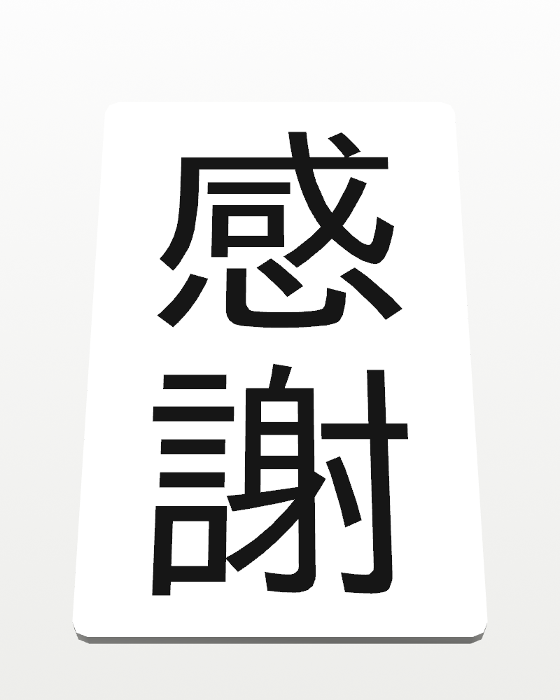
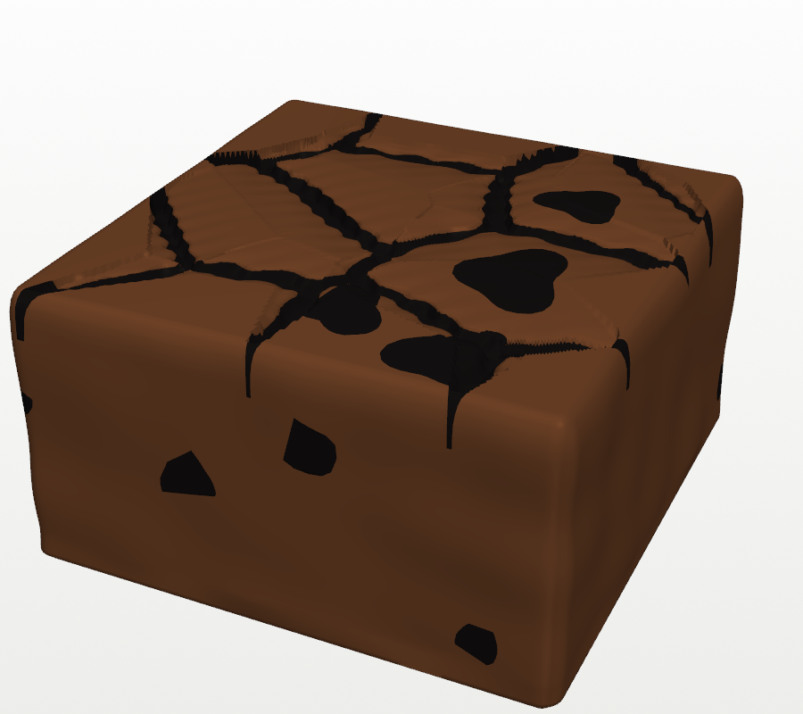
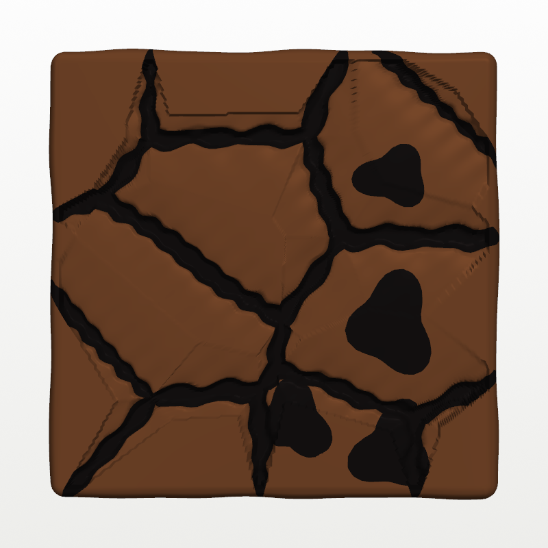
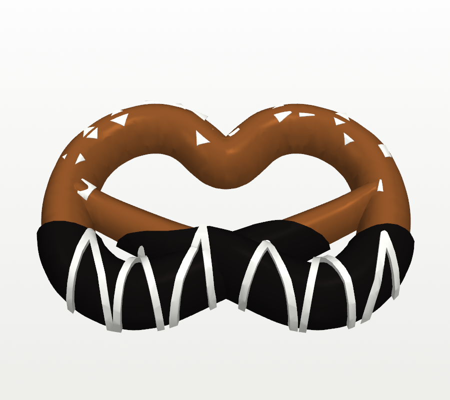
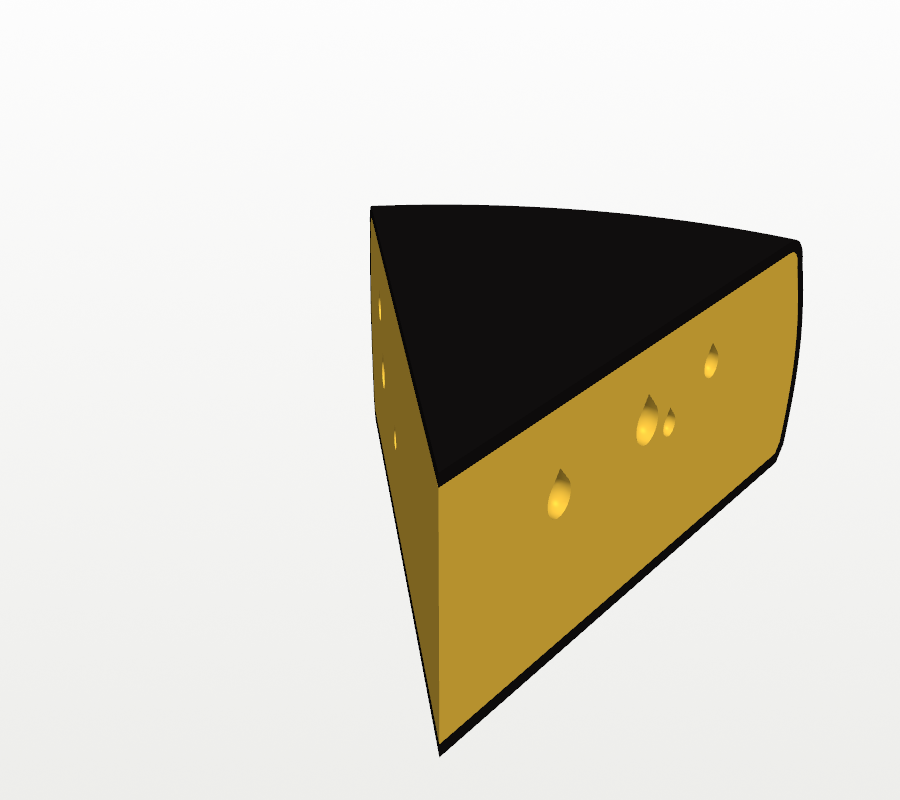
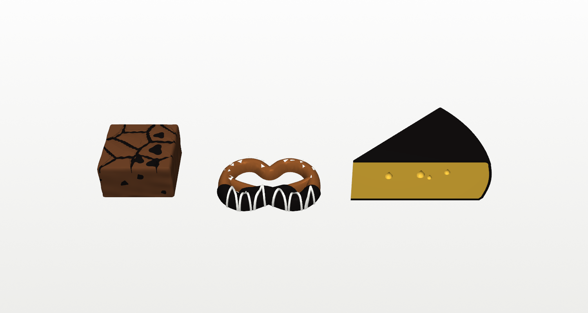

# Snack basket

A little brown wicker basket with a handle, and treats to put in it: two
apples, a chocolate-chip cookie, a brownie, chocolate-dipped pretzels, a wedge of
cheese, a bag of snacks and a little thank-you card
that says 感謝 ("gratitude"). The basket is 83 × 69 mm
across the rim (a bit narrower than the [samosa](../samosa/), which is 86 mm)
and 30 mm deep, or 71 mm tall to the top of the handle. Put in whichever
you like: the apples, the cookie, the bag and the card fit in together as
the pictures show, and the build script checks they don't poke through the
basket, the handle or each other. The brownie, the pretzels and the cheese
are extras, like the things in a gift basket you'd swap in and out. Each
one is checked to fit in the basket on its own.

| | | |
|---|---|---|
|  |  |  |
|  |  |  |
|  |  |  |
|  |  |  |

The picture at the end of the second row shows it next to the samosa.

## What's in it

| Part | Size | What it looks like |
|---|---|---|
| **Basket** | 83 × 69 × 30 mm | Eight woven rows going over and under 36 stakes, a twisted rope rim, and a faint weave inside. Its outline is a rounded rectangle and it flares out slightly towards the top. A thick stake inside the rim on each long side has a socket for the handle. |
| **Handle** | 58 × 51 mm, 5 mm wide and 4 mm thick | An arch with slanted grooves, like a wrapped wicker handle. It prints flat. Its two pegs push down into the sockets, and its shoulders rest on top of the stakes. |
| **Apple** (×2) | 25 mm across, 25 mm tall | Round and a little fuller at the shoulders, with five soft lobes round the bottom and a short curved stem in a dimple on top. It stands on a small flat spot on its bottom. |
| **Cookie** | 28 mm across, 6 mm thick | Slightly domed, with an uneven edge and eleven chocolate chips on top. |
| **Bag of snacks** | 30 × 42 × 10 mm | A puffy bag with crimped seals and zigzag-cut ends at the top and bottom, with SNACKS raised on an oval label. It's flat on the back, like a bag lying on a table. |
| **Brownie** | 22 × 22 × 12 mm | A square cut from the pan. The cut sides are crumbly, and the crust on top has cracked into puffy plates with dark fudge showing in the cracks. Chocolate chunks melt out of the top and show as broken pieces in the cut sides. Printed in brown and black with the AMS. |
| **Chocolate-dipped pretzel** | 32 × 22 mm, 3.4 mm thick (4.6 mm at the crossing) | A classic knotted pretzel, flat underneath. One end crosses over the other, and both ends press onto the loop. The bottom half is dipped in black chocolate with a wavy dip line and a hand-flicked white drizzle. Coarse white salt sits on the plain half. Printed in brown, black and white with the AMS. |
| **Cheese wedge** | 41 × 27 × 16 mm | A wedge of aged gouda cut from a wheel, with slightly bulging sides. Black wax coats the rind, top and bottom, and the yellow cut faces have a few small holes. Printed in yellow and black with the AMS. |
| **Thank-you card** | 26 × 42 mm, 1.2 mm thick | A plain white card with 感謝 in black, written top to bottom: 感 above 謝. The characters are inlaid flush with the face, so the card is smooth and flat like paper. Its corners are slightly rounded. |

In the pictures the bag stands at one end leaning on the wall with an apple
beside it, and the card stands behind that apple, leaning back on the far
wall. The other apple and the cookie sit at the other end. The handle runs
between them. The handle is narrow, so you can put them in any way you like,
or swap something for one of the extras.

- **Fit:** the handle's pegs have a 0.2 mm gap all round in their sockets.
  They should push in snugly. A dab of glue holds them for good.

## Printing

Each part prints on its own. The basket, the apples, the cookie and the bag
are one colour each. The card, the brownie, the pretzels and the cheese use
the AMS. Every project uses **0.20mm Standard @BBL A1** with no supports and no brim. The
build script checks that nothing overhangs more than 45°.

| Project | Parts | Filament | Walls | Filament used (my estimate) |
|---|---|---|---|---|
| `basket.3mf` | basket and handle, on one plate | brown PLA | 4 (the wall prints solid) | about 40 g |
| `apple.3mf` | two apples, on one plate | red PLA | 3 | about 12 g |
| `cookie.3mf` | cookie | tan or light-brown PLA | 3 | about 3 g |
| `snack_bag.3mf` | bag of snacks | any bright PLA (orange in the pictures) | 3 | about 6 g |
| `pretzels.3mf` | three pretzels, on one plate | brown (filament 1), black (2) and white (3) PLA, with the AMS | 3 | about 5 g, plus the purge between colours |
| `cheese.3mf` | cheese wedge | yellow (filament 1) and black (filament 2) PLA, with the AMS | 3 | about 8 g, plus the purge between colours |
| `brownie.3mf` | brownie | brown PLA (filament 1) and black PLA (filament 2), with the AMS | 3 | about 7 g, plus the purge between colours |
| `card.3mf` | thank-you card | white PLA (filament 1) and black PLA (filament 2), with the AMS | 3 | about 2 g, plus the purge between colours |

Infill is 15% throughout. Bambu Studio will show the exact amount and time
when you slice.

- **Orientation:** the basket and the apples print upright, the cookie lies
  flat and the bag lies on its flat back. The handle prints flat with its
  grooved side up. The card lies flat, face up, and the brownie prints upright. The pretzels lie flat, and the cheese stands on the
  bottom of the wheel.
- **Card:** load white PLA as filament 1 and black as filament 2. The
  characters are only in the top two layers (0.4 mm), so the AMS changes
  colour on just those two layers. The project sets a generous purge between
  the colours so no black streaks the white. The strokes are at least as wide
  as the nozzle (the build script checks), so every stroke of 謝 prints.
- **Brownie:** load brown PLA as filament 1 and black as filament 2. The
  black is the fudge in the crust's cracks (only in the top layers) and the
  chocolate chunks. The chunks in the cut sides mean the AMS changes colour
  on most layers, so it takes a while and purges more than the card. The
  project sends that purge into the brownie's own infill (20%), where it's
  hidden, instead of all of it into the prime tower. Set `SIDE_CHUNKS = 0`
  and rebuild for a brownie that only changes colour near the top.
  A matte brown looks most like cake. A glossy black makes the chunks and
  fudge look melted.
- **Pretzels:** load brown PLA as filament 1, black as 2 and white as 3. The
  dipped half has black and white on every layer, so expect a colour change
  or two per layer there. The plain half is brown with the salt only in the
  top layers. The purge goes into each pretzel's infill where there's room,
  and the rest into the prime tower.
- **Cheese:** load yellow PLA as filament 1 and black as 2. The wax is on the
  rind all the way up, so the AMS changes colour on every layer, and the
  purge goes into the wedge's infill (20%). The holes in the cut faces are
  teardrop-shaped at the top so they print without support.
- **Apple stem:** the stem is small (2.2 mm across). If it comes out droopy,
  slow the printer down for the last few layers. Printing both apples at once
  already helps, because each layer has longer to cool.
- Or import the STLs from `stl/` and use the settings above
  (`assembled.stl` is for viewing only).

**Paint (optional):** a dot of dark brown on each of the cookie's chips, a
brown stem on each apple, and a dark wash on the basket that you wipe off the
top of the weave all make them look more real.

## Changing it

The parameters at the top of `build_basket.py` set:

- the basket's size (`BOT_A`, `BOT_B`, `TOP_A`, `TOP_B`, `WALL_H`) and outline
  (`SQUARE`: 2 is an oval, higher is squarer)
- the weave (`STAKES`, `ROWS`, `WEAVE`, `INNER_WEAVE`) and the rim (`RIM_OUT`,
  `RIM_TWISTS`)
- the handle (`HANDLE_RISE`, `HANDLE_W`, `HANDLE_T`) and the peg fit (`FIT`)
- the apple (`APPLE_R`, `APPLE_SHOULDER`, `APPLE_DIMPLE`), the cookie
  (`COOKIE_R`, `CHIPS`, `SEED`) and the bag (`BAG_W`, `BAG_L`, `BAG_PUFF`,
  `LABEL` for the word on the front)
- the brownie (`BROWNIE_W`, `BROWNIE_H`, the crust's `CRUST_CELLS`,
  `CRACK_W` and `PUFF`, `TOP_CHUNKS`, `SIDE_CHUNKS`, `CRUMB`, and
  `BROWNIE_SEED` for a differently cracked one)
- the pretzel (`PRETZEL_W`, `STRAND`, `STRAND_H`, `COATING`, `DIP_AT`, where
  the dip line is, `DRIZZLE_W`, `SALT`, and `PRETZEL_SEED` for a different
  drizzle)
- the cheese (`WHEEL_R`, `WHEEL_H` and `WEDGE_ANGLE` for the size of the
  wedge, `WHEEL_BULGE`, `WAX`, `EYES`, and `CHEESE_SEED`)
- the card (`CARD_W`, `CARD_H`, `CARD_T`, `CARD_TEXT`, `CHAR_SIZE`, and `INK`,
  how deep the characters go)

The script stops with an error if a change makes anything overhang more than
45°, makes the basket wider than the samosa (86 mm), or stops the treats
fitting in the basket. If you make a treat bigger, move it in `arrange()`
(`APPLE2_AT` places the second apple and `CARD_AT` the card). It also stops if
the card's characters have strokes too thin to print.

The card needs a font with Japanese characters. The script uses the first
one it finds from the list in `CJK_FONTS`: IPAGothic or Noto Sans CJK on
Linux, Hiragino on a Mac, or Yu Gothic or MS Gothic on Windows. On
Debian/Ubuntu, `sudo apt install fonts-ipafont-gothic` installs IPAGothic,
which the STLs here were made with.

```
pip install trimesh numpy scipy manifold3d vtk pillow matplotlib
python3 build_basket.py        # -> stl/
xvfb-run -a python3 render.py  # -> images/ (drop xvfb-run on a desktop)
python3 make_3mf.py            # -> basket.3mf, apple.3mf, cookie.3mf, snack_bag.3mf, card.3mf, brownie.3mf,
                               # pretzels.3mf, cheese.3mf
```

## Files

| File | What |
|---|---|
| `build_basket.py` | Builds every part, places the treats (both apples) and the card in the basket and checks they fit, and that each extra fits on its own. |
| `render.py` | Preview renders (VTK). |
| `make_3mf.py` | Builds the Bambu Studio projects with `../tools/bambu3mf.py`. |
| `basket.3mf`, `apple.3mf`, `cookie.3mf`, `snack_bag.3mf`, `card.3mf`, `brownie.3mf`, `pretzels.3mf`, `cheese.3mf` | Bambu Studio projects, ready to slice. |
| `stl/` | `basket.stl`, `handle.stl`, `apple.stl`, `cookie.stl`, `snack_bag.stl`, `card.stl` (white) and `card_ink.stl` (black characters), `brownie.stl` (brown) and `brownie_choc.stl` (black chocolate), `pretzel.stl` (brown), `pretzel_choc.stl` (black) and `pretzel_white.stl` (drizzle and salt), `cheese.stl` (yellow) and `cheese_wax.stl` (black), and `assembled.stl` for viewing. |
