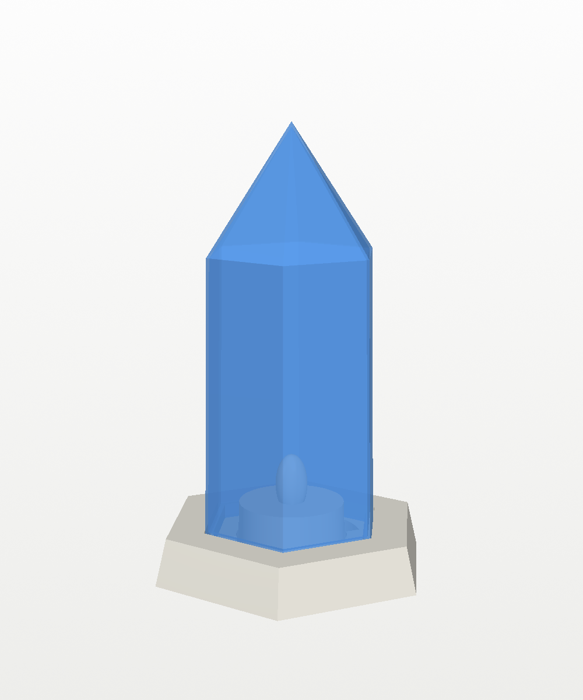
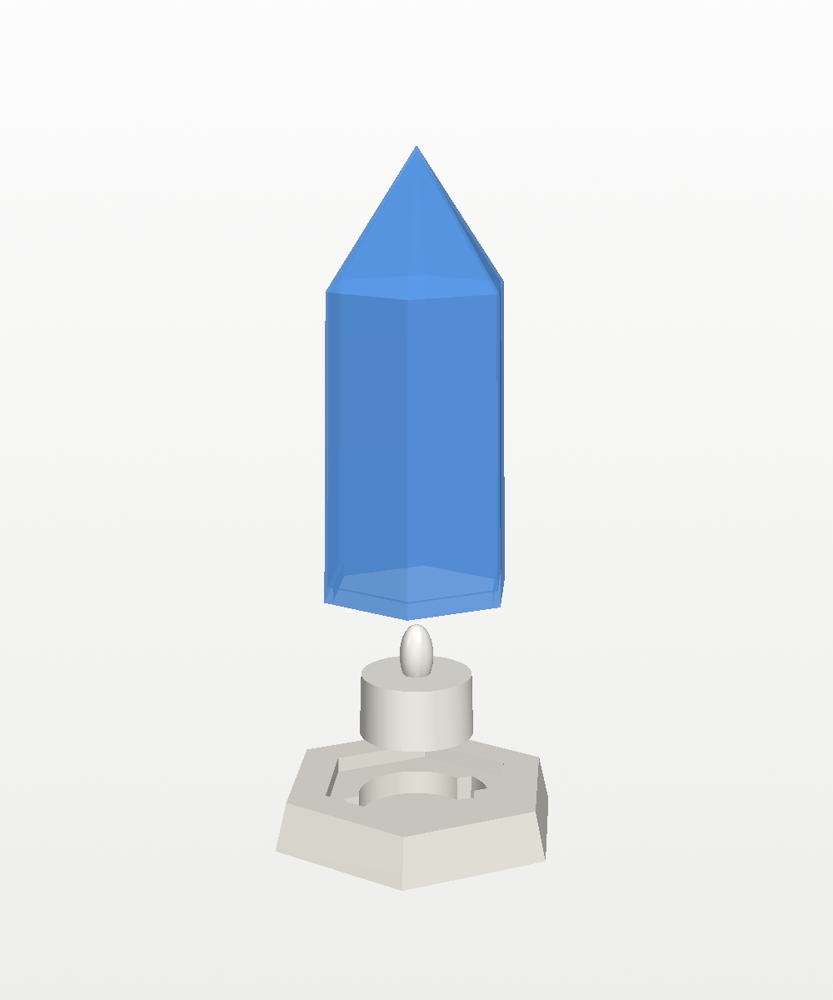
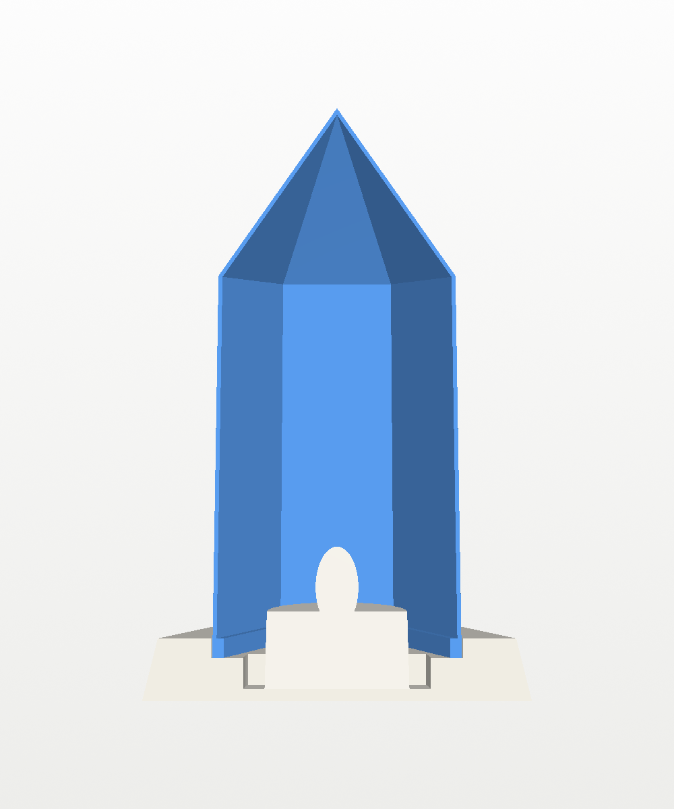
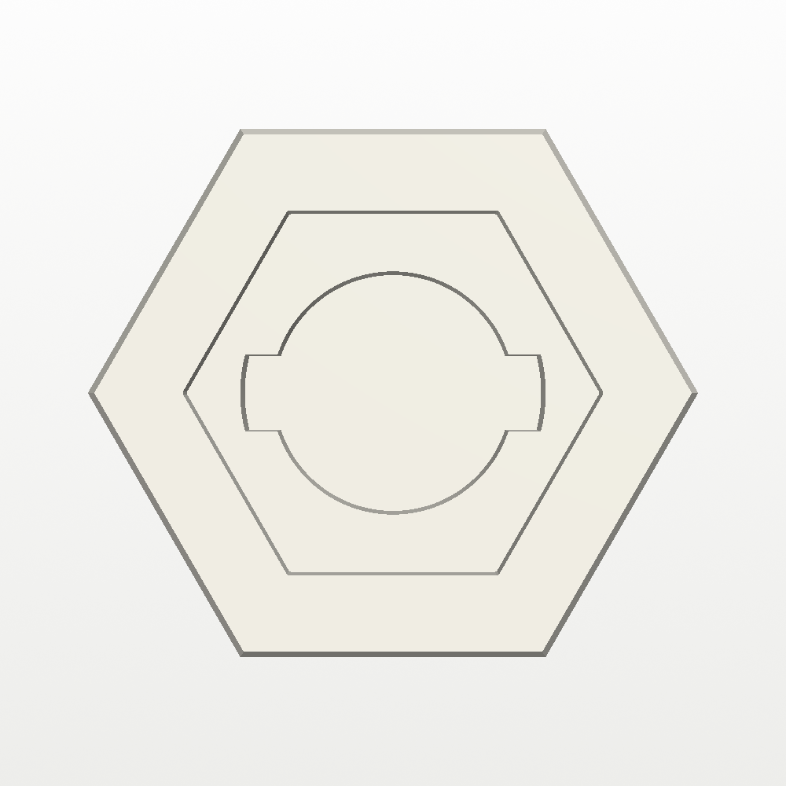

# Tea Light Crystal

A single hexagonal blue crystal lit from inside by one LED tea light. It's
about 6 in (152 mm) tall. The crystal prints in **translucent blue PLA** and
lifts straight off a white hexagonal base, so the tea light's switch is easy
to reach.

| | | |
|---|---|---|
|  |  |  |

## What it is

- **Light:** one [Bambu Lab LED Flame Tea Light](https://us.store.bambulab.com/products/led-flame-tea-light-candle-set-warm-yellow)
  (37.2 mm across, 36.6 mm tall, CR2032 battery).
- **Crystal (blue):** a regular hexagonal crystal 141 mm tall, 64 mm across
  the corners. The prism narrows slightly towards a six-sided point that
  starts 98 mm up.
  - It's a hollow shell 0.9 mm thick (two printed lines), open underneath.
  - A thicker band inside the bottom 5 mm stiffens the rim and hides in the
    socket.
- **Base (white):** a low hexagon lined up with the crystal, 100 × 87 × 16 mm,
  with its sides sloping in slightly.
  - The tea light sits in a 38.2 mm pocket, 0.5 mm clearance all round.
  - Around the pocket is a hexagonal socket 5 mm deep, shaped to the
    crystal's foot with 0.4 mm clearance, so the crystal can't slide off. It
    drops in any of six ways round.
- **Clearances:** the crystal clears the tea light by at least 6.5 mm all
  round, and the flame sits well below the point.



**Switching it on and off:** lift the crystal off. The tea light stands
about 24 mm above the base, and two finger notches beside it (towards the
left and right corners) let you pinch it out to reach the switch underneath.



## Printing

Two plates, one per filament. Both print upright with no supports.

| Project | Part | Filament | Settings beyond **0.20mm Standard @BBL A1** |
|---|---|---|---|
| `crystal_base.3mf` | base | white PLA | 3 walls, 15% infill, no brim |
| `crystal_top.3mf` | crystal | **PLA Translucent blue** | 2 walls, 0% infill, Arachne walls, 5 mm outer brim |

- **Printer and filament presets:** both projects use **Bambu Lab A1 0.4
  nozzle** and **Bambu PLA Basic @BBL A1**. For the crystal, switch the
  filament to your translucent PLA profile if you have one.
- **Seam:** set to *aligned*, which puts it in one of the crystal's vertical
  corners, where it's hard to see.
- **Brim:** the crystal stands 141 mm tall on a 2.5 mm foot, so it gets a
  brim to stay put while the A1's bed moves. The brim edge sits inside the
  socket and doesn't show.
- **Overhangs:** the point's facets are 59° from horizontal, so the inside
  of the point prints without support.

Or import the STLs from `stl/` (`base.stl`, `crystal.stl`). `assembled.stl`
is for viewing only.

**Single wall instead of two:** if two walls aren't bright enough, the crystal
can print as a single wall. Rebuild with `WALL = 0.45` and slice with one wall
loop, or print `crystal.stl` in vase mode (spiral, no bottom layers). It
glows brighter but is more fragile.

## Changing it

The parameters at the top of `build_crystal.py` set:

- the tea light size
- the crystal's radius, where the point starts (`SHOULDER_H`) and its taper
- `ROTATION`, which way the flat faces point
- the wall thickness
- `SOCKET_FIT`, the socket clearance (0.4 mm)

The script stops with an error if a change makes the point too flat to print
(under 50°) or the crystal too narrow for the tea light.

```
pip install manifold3d trimesh numpy vtk pillow
python3 build_crystal.py        # -> stl/
xvfb-run -a python3 render.py   # -> images/ (drop xvfb-run on a desktop)
python3 make_3mf.py             # -> crystal_base.3mf, crystal_top.3mf
```

## Files

| File | What |
|---|---|
| `build_crystal.py` | Builds the base and the crystal. Its key dimensions are parameters at the top. |
| `render.py` | Preview renders (VTK), with a stand-in tea light. |
| `make_3mf.py` | Builds the two Bambu Studio projects with `../tools/bambu3mf.py`. |
| `stl/` | `base.stl`, `crystal.stl`, and `assembled.stl` for viewing. |
