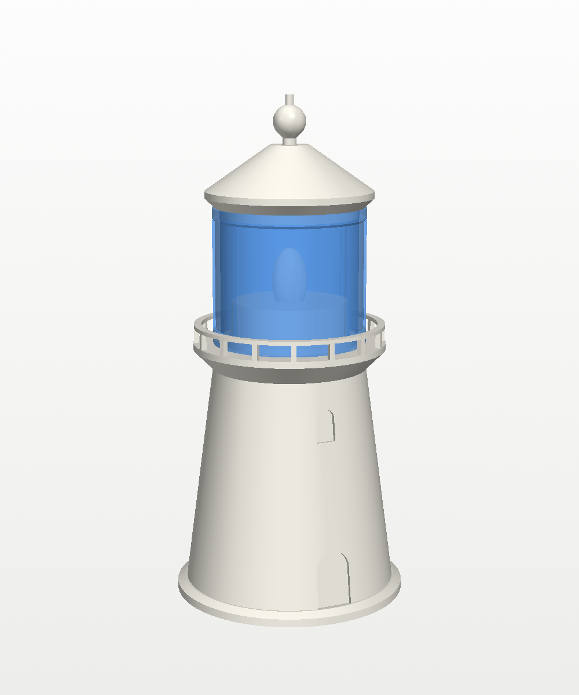
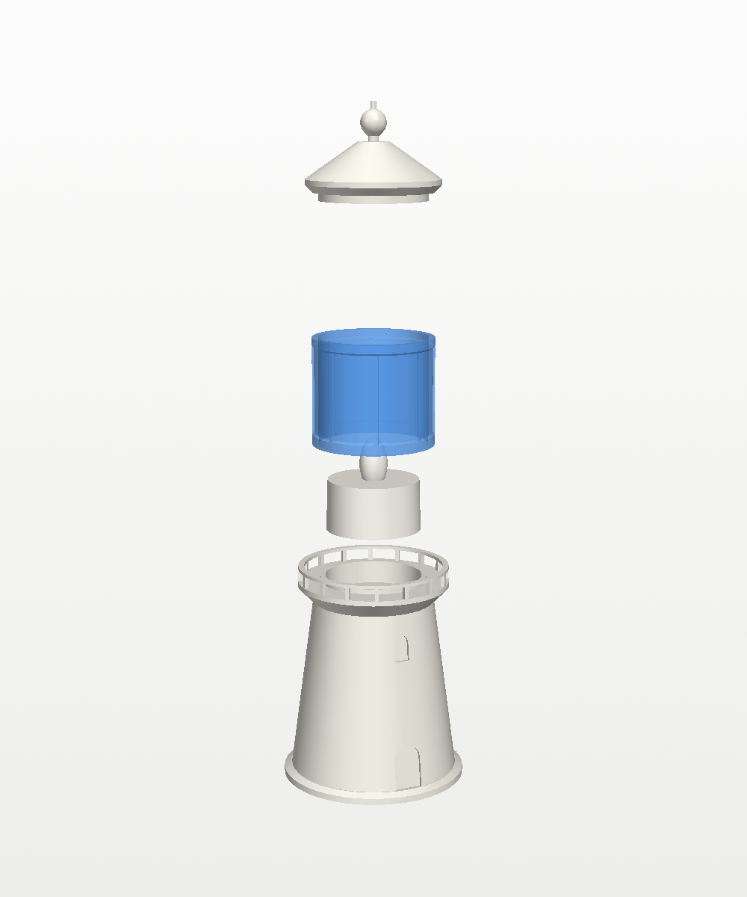
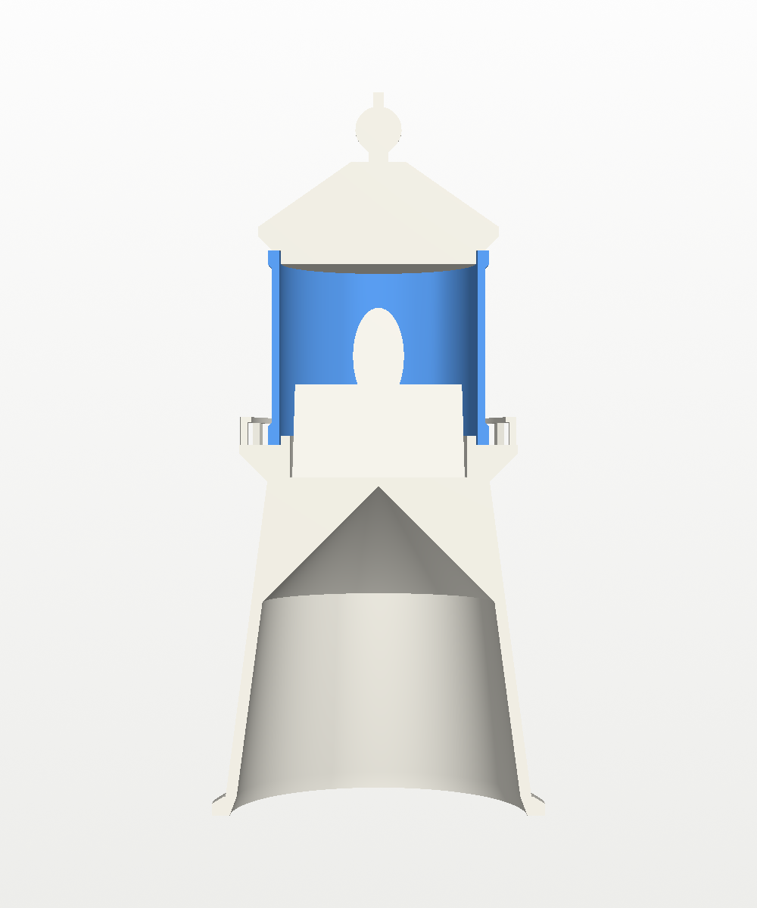

# Tea Light Lighthouse

A small desk lighthouse lit by one LED tea light. The tower and roof print in
an opaque colour, and the lantern room prints in **translucent blue PLA**, so
the flickering tea light inside glows blue like a beacon.

| | | |
|---|---|---|
|  |  |  |

## What it is

- **Light:** one [Bambu Lab LED Flame Tea Light](https://us.store.bambulab.com/products/led-flame-tea-light-candle-set-warm-yellow)
  (37.2 mm across, 36.6 mm tall including the flame, CR2032 battery).
- **Size:** 72 mm across the base and 156 mm tall.
- **Three parts, no glue:**
  - **Tower:** a plinth, a tapered tower with a door and three windows, and a
    gallery deck with railing. The tea light drops into a 38.2 mm pocket on
    top (0.5 mm clearance all round, 9 mm deep). The tower is hollow and open
    underneath to save filament.
  - **Lantern:** the glass room, a 1.6 mm wall with eight mullions and a band
    at each end. It slips over a locating ring on the deck.
  - **Roof:** a cone roof with a ventilator ball and finial. A spigot on its
    underside plugs into the lantern.
- **Clearance:** the top of the flame sits about 9 mm below the roof, so a
  slightly taller tea light still fits.

**Switching it on and off:** the tea light's switch is underneath. Lift the
roof and lantern off together and pull the tea light out by its body (the top
27 mm stands clear of the pocket), switch it on, and drop it back in.



## Printing

Everything prints upright with no supports and no brim. Every overhang is
either 45° or a short bridge (the railing's top rail between its 16 posts).

| Project | Parts | Filament |
|---|---|---|
| `lighthouse_white.3mf` | tower and roof | white, or any opaque colour |
| `lighthouse_lantern.3mf` | lantern | **PLA Translucent blue** |

Both projects select these presets:

- Printer: **Bambu Lab A1 0.4 nozzle**
- Filament: **Bambu PLA Basic @BBL A1**. For the lantern, switch it to your
  translucent PLA profile if you have one.
- Process: **0.20mm Standard @BBL A1**, with no brim, no supports and the seam
  at the back. Other changes:
  - **Tower and roof:** 3 walls and 10% infill.
  - **Lantern:** 4 walls and no infill, so the walls fill the whole 1.6 mm
    glass and no infill pattern shows through when it's lit.

Or import the STLs from `stl/` (`tower.stl`, `lantern.stl`, `roof.stl`).
`assembled.stl` is for viewing only.

**Optional stripes:** for a red-and-white tower, add colour changes on the
tower in Bambu Studio's layer slider. Bands every 16–18 mm between the plinth
(4 mm) and the corbel (72 mm) look right.

## Changing it

`build_lighthouse.py` has the key dimensions as parameters at the top:

- the tea light size (`TEA_D`, `TEA_H`)
- the pocket clearance and depth
- the tower height and taper
- the lantern height and wall
- `FIT`, the clearance on the lantern and roof spigots

The first print is the real test. If the lantern or roof is too tight or too
loose, change `FIT` (0.4 mm radial by default).

```
pip install manifold3d trimesh numpy vtk pillow
python3 build_lighthouse.py     # -> stl/
xvfb-run -a python3 render.py   # -> images/ (drop xvfb-run on a desktop)
python3 make_3mf.py             # -> lighthouse_white.3mf, lighthouse_lantern.3mf
```

## Files

| File | What |
|---|---|
| `build_lighthouse.py` | Builds the three parts. Its key dimensions are parameters at the top. |
| `render.py` | Preview renders (VTK), with a stand-in tea light. |
| `make_3mf.py` | Builds the two Bambu Studio projects with `../tools/bambu3mf.py`. |
| `stl/` | `tower.stl`, `lantern.stl`, `roof.stl`, and `assembled.stl` for viewing. |
